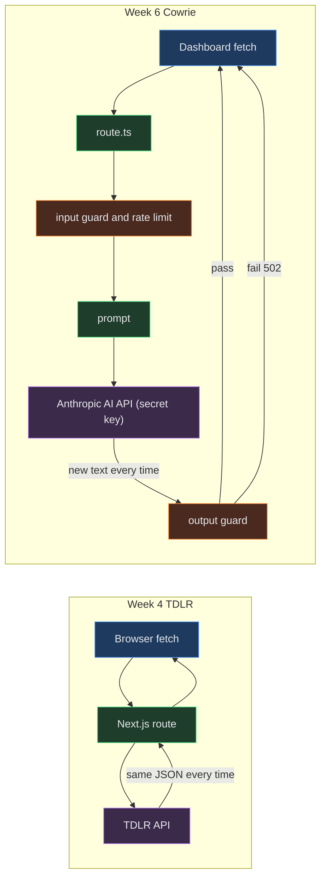
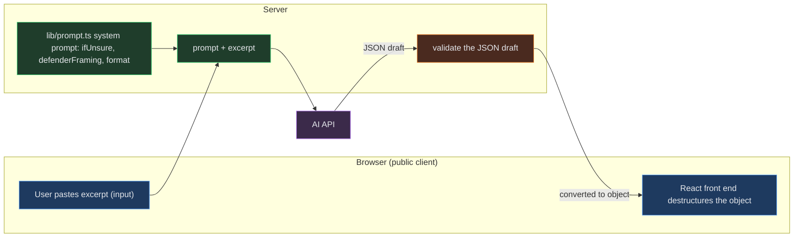
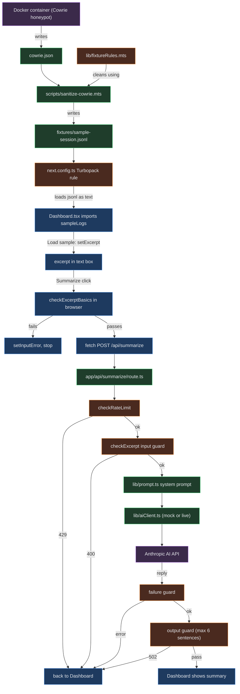

# Evidence: how the build maps to the course

<b>Joseph writes every answer. Agents only format, under the rule in CLAUDE.md §6, after Joseph's yes.</b> The course map is drawn only from the repo, git history and CLAUDE.md; anything not yet built or proven is marked TBD.

---

## Course map

<table>
  <tr><th>Course topic</th><th>What the build does for it</th><th>Where it lives (file or command)</th></tr>
  <tr><td>W6 · Call an AI API from your own code, in the back end</td><td>The summarize route calls Claude Haiku 5.5 (<code>claude-haiku-5-5</code>) through an AI client seam; the browser never calls the AI. Live call proven Oct 26 2026 (520 in / 147 out tokens).</td><td><code>app/api/summarize/route.ts</code>, <code>lib/aiClient.ts</code>, <code>lib/liveAiClient.ts</code> (#5, 7aa9122)</td></tr>
  <tr><td>W6 · Show the AI result in the UI</td><td>The dashboard shows the summary, the threat badge, tokens in/out and the cost of that call.</td><td><code>app/_components/Dashboard.tsx</code> (#3, fd81399)</td></tr>
  <tr><td>W6 · Keep the key secret</td><td>The key is read only from <code>process.env.ANTHROPIC_API_KEY</code> on the server; <code>.env*</code> is git-ignored except <code>.env.example</code>; CI runs a gitleaks secret scan on the full history. In Week 7 the sandboxed builder sees only an <code>openshell:resolve:</code> placeholder.</td><td><code>lib/liveAiClient.ts</code>, <code>.gitignore</code>, <code>.github/workflows/ci.yml</code> (gitleaks 8.30.1), <code>lab/openshell/policy.yaml</code></td></tr>
  <tr><td>W6 · System prompt in code (role + rules)</td><td>Joseph's prompt, 7 parts (role, task, untrusted excerpt, no added facts, <code>unknown</code> if unsure, defender framing, format); the excerpt is wrapped in <code>&lt;log_excerpt&gt;</code> tags and tag breakouts are neutralized.</td><td><code>lib/prompt.ts</code>, <code>lib/prompt.test.ts</code> (#5)</td></tr>
  <tr><td>W6 · Change behavior through the system prompt</td><td>The format part changed from v1 to v2 (now 6 sentences, under 700 characters), with matching output guard limits. One combined commit, so the diff is not prompt-only (verifier T16, skipped by Joseph).</td><td><code>lib/prompt.ts</code> (#5 C9, 97b276b)</td></tr>
  <tr><td>W6 · Tokens and cost per call</td><td>Cost is calculated on the server from <code>usage</code> × dated prices ($0.10 in / $0.50 out per 1M, price date 2026-10-06). Measured runs: $0.000125 (2-line excerpt) to $0.000727 (sample). The input card states about $0.0001–$0.0008 per call.</td><td><code>lib/cost.ts</code>, <code>lib/cost.test.ts</code>, <code>app/_components/Dashboard.tsx</code></td></tr>
  <tr><td>W6 · Cap the input</td><td>Excerpts over 4,000 characters are rejected with the actual count, never truncated; uploads over 50 KB are rejected in the browser before reading.</td><td><code>lib/inputGuard.ts</code>, <code>app/_components/Dashboard.tsx</code> (#8, 65216c5)</td></tr>
  <tr><td>W6 · Cap the output</td><td><code>max_tokens</code> 2,048 and effort <code>low</code> on the AI call; the summary is held to 6 sentences and 700 characters.</td><td><code>lib/liveAiClient.ts</code>, <code>lib/outputGuard.ts</code></td></tr>
  <tr><td>W6 · Handle rate limits without crashing</td><td>One summary per minute per client (keyed only on <code>x-nf-client-connection-ip</code>, hashed); HTTP 429 with <code>Retry-After</code>; the dashboard shows an amber alert and a countdown. A provider 429 shows "The AI service is busy." Whether Netlify sends the header: TBD at deploy.</td><td><code>lib/rateLimit.ts</code>, <code>lib/retryAfter.ts</code>, <code>lib/aiFailure.ts</code> (#12, 7290f90 and bf39d95)</td></tr>
  <tr><td>W6 · Guardrail: bad input</td><td>Empty, over-length and non-Cowrie input is rejected before the AI call, with the same quick checks repeated in the browser.</td><td><code>lib/inputGuard.ts</code>, <code>lib/inputGuard.test.ts</code> (#8)</td></tr>
  <tr><td>W6 · Guardrail: bad output</td><td>A Zod schema checks the JSON reply (summary length and sentences, one of four labels); refusals and schema failures show "Couldn't produce a reliable summary for this excerpt."</td><td><code>lib/outputGuard.ts</code>, <code>lib/outputGuard.test.ts</code> (#10, b2c7a81)</td></tr>
  <tr><td>W6 · Guardrail: failure or slowness</td><td>8,000 ms timeout with 0 retries; timeouts, 5xx, connection and auth errors map to a log code and a friendly message; the rest of the page keeps working.</td><td><code>lib/aiFailure.ts</code>, <code>lib/aiFailure.test.ts</code> (#10)</td></tr>
  <tr><td>W6 · Test without spending tokens</td><td><code>AI_MODE</code> defaults to mock; <code>AI_MOCK_SCENARIO</code> triggers success, bad output, refusal, timeout or rate limit through the same guards.</td><td><code>lib/aiMode.ts</code>, <code>lib/mockAiClient.ts</code> (#2, #3, #10)</td></tr>
  <tr><td>W6 · Name the failure mode and its guardrail</td><td>Main failure mode: prompt injection in the honeypot logs. The sample fixture has one injection line; the guard is the <code>&lt;log_excerpt&gt;</code> wrapping plus prompt rule 3, with the Zod check as the backstop.</td><td><code>fixtures/sample-session.jsonl</code>, <code>lib/prompt.ts</code>, <code>lib/outputGuard.ts</code> (CLAUDE.md D14)</td></tr>
  <tr><td>W6 · Govern: tell the user it's AI</td><td>"AI generated · verify before acting" above every summary; header pills (Live/Mock AI, Sample logs only, 1 request / min); defender footer.</td><td><code>app/_components/Dashboard.tsx</code>, <code>app/_components/Header.tsx</code>, <code>app/_components/Footer.tsx</code></td></tr>
  <tr><td>W6 · Explain the data flow, including the AI call</td><td>Joseph's Day 1 answer and call graph below trace click → route → guards → AI → screen. README diagram: TBD (Week 7 Step 7, #19).</td><td>This file, "Summarize data flow" section; <code>README.md</code> TBD</td></tr>
  <tr><td>W6 · Review diffs, small commits</td><td>Every ticket runs through the verifier subagent (typecheck, lint, tests, a mock dev server, checks 1 to 12) and one <code>REVIEW.md</code>; Joseph approves or skips each finding and commits.</td><td><code>.claude/agents/verifier.md</code>, <code>REVIEW.md</code>, <code>git log</code></td></tr>
  <tr><td>W6 · Catch an agent mistake</td><td>Verifier FAILs that were approved and fixed: the <code>&lt;/log_excerpt&gt;</code> breakout (#5 F1) and IPs missed by <code>redactIps</code> (Week 7 Step 3, A4).</td><td><code>lib/prompt.ts</code> (<code>neutralizeExcerptTags</code>), <code>lib/redactIps.ts</code> (e12c4af)</td></tr>
  <tr><td>W6 · Log prompts</td><td>TBD (PROMPT_LOG.md, Part 2).</td><td>TBD</td></tr>
  <tr><td>W6 · Runs locally and on GitHub, no secrets committed</td><td>Runs with the dev server in mock or live mode; CI runs typecheck, lint, tests and gitleaks on every push to <code>main</code> and every pull request.</td><td><code>npm run dev</code>, <code>.github/workflows/ci.yml</code> (#15, d5a4e9b)</td></tr>
  <tr><td>W7 · Database: save runs</td><td>After the output guard passes, live runs are saved to Neon through Prisma: summary with IPs replaced by "attacker IP", label, mode, tokens, cost, excerpt length and SHA-256; never the raw excerpt. A database failure never blocks the summary.</td><td><code>prisma/schema.prisma</code>, <code>lib/runStore.ts</code>, <code>lib/prismaRunStore.ts</code>, <code>lib/redactIps.ts</code> (#16 part 1, e12c4af); migration <code>init_saved_runs</code> (b95cc35)</td></tr>
  <tr><td>W7 · Database: history list, view, delete</td><td>TBD (Step 4, skipped for now).</td><td>TBD</td></tr>
  <tr><td>W7 · Production deploy with env vars</td><td>TBD (Step 6, #13).</td><td>TBD</td></tr>
  <tr><td>W7 · Real users try it</td><td>TBD (#18).</td><td>TBD</td></tr>
  <tr><td>W7 · Rehearsed live agent change</td><td>TBD.</td><td>TBD</td></tr>
</table>

---

## Joseph's answers

### AI API compared with a regular API

**1. What's the same (Week 4)**

In Week 4 we created a full stack application where the browser used fetch to send an HTTP request to an application programming interface endpoint on the server side, using Next.js to fetch and receive data. We had no control over the data or how it was managed, because that's the job of the host. We just used the endpoint to ask for something and managed the response and how it was received. Using the TDLR API endpoint, the data was the same shape every time. The endpoint always sent back the same JSON structure, and the same request gave the same answer. That predictability is why we didn't need an output guard.

**2. What's different: the key and cost**

With the actual AI API key, it was different. We had to go to Anthropic, add funds to our account, and create a workspace with a fixed spending limit so that requests sent to the API client wouldn't be abused. The cap was a comprehensive gate protecting key usage. The key itself is a secret that should never be in the browser, because it corresponds to our personal Anthropic account with real funds. The browser is a place the public has access to, so you never want to put secrets, personal information, or even requests or references to that information on the client side. The Next.js server side implementation was crucial here. Making sure the API key was never copied into chats, pushed to the repository, or placed anywhere it would be exposed was essential.

**3. What's different: guarding the request**

Requests were rate limited, and each request had an allocated period of time, so that re-requests outside the allowed amount and time period were handled correctly with a response message and response code. Input needed to be validated, and an indicator needed to show when the live AI was being used. Validation and the steps after it had to be coordinated within the rate limiting window. Limiting the entry point to the server side with strict guards, plus fast checks on both the browser side and the server side, was essential. This also required mock testing, to test the sequential data flow end to end without using real tokens.

**4. What's different: prompt, model and tokens**

Input needed to be passed to the AI using a prompt framework that gave the AI specific instructions on its role, rules, constraints, and how to format its output. The cost for input tokens and output tokens per million needed to be assessed. Output is expected to cost a bit more, and thinking output (the internal steps that help form the response) adds to it by a small factor, depending on the request, the job the AI is doing, and how you frame it. The format instructions set the framework around token usage: you can ask for minimal output or increase it, but that control is essential. Picking a model was also important, one with adequate compute for the job that didn't cost too much per round trip. Anthropic also had an AI SDK available.

**5. What's different: what comes back**

With the AI, what's different is inside the JSON. Because the AI generates text instead of looking it up, the model writes new text each time, so the same input can give different wording, and sometimes it breaks your rules. The prompt shapes the answer, but it's a request, not a guarantee. In our project, the 502 proves that: the AI sent back too many sentences, and the output guard caught it. Tokens are how the text is measured and billed. Knowing the AI is prone to mistakes, output guards on the AI's response were necessary. Because you control the expectation of how the AI and the app should work, you also need clear communication to the user when information can't be validated, the app fails at any point, or actions happen out of sequence. Once input, prompt, output, and response handling were in place, all of the server side responses had to get back to the client side, where the components could show the state changes, the output, token usage, and money spent.

#### Q1 call graph

### The system prompt

**1. Where it lives**

The system prompt lives in lib/prompt.ts and that code runs on the server, not in the browser. That matters because keeping it server side keeps the prompt's contents and control over the model's behavior off the public client, where they could be read or interfered with.

**2. What it does**

ifUnsure is a key value pair that says, if this data looks like anything outside of the usual and fits any one of these particular edge cases or scenarios, then this is how I want you to classify it.

Defender framing assigns the AI a defensive only role. It critiques responses strictly for defense, never gives attack steps, never improves an attacker's commands, and never explains how to evade detection.

Format is a key value pair that says, I've given you all these instructions, these rules, these conditions and scenarios, but at the end of the day I've given you constraints as well. I want you to apply all of these things and bake this recipe and it will come out in this specific format. It's going to be JSON because the JSON needs to be something that can be validated after the draft, and then converted back into an object so that it can be destructured and utilized by the front end with React.

**3. Input vs prompt**

The excerpt the user pastes is the input. The system prompt is an instructional framework that tells the AI how to understand the input, but also how to set constraints on the output.

**4. Week 2 tie**

In Week 2 we learned how to create an effective prompt: how to shape the input and set constraints on the output to get an intended result.

#### Q2 call graph

### Summarize data flow

**1. Data flow**

The click stays in the browser and hits the backend route. The backend runs the rate limit, then the input guard, builds the prompt, calls the AI client in mock or live mode, runs the failure guard and the output guard, and sends the summary back to the Dashboard. The AI key never leaves the server.

**2. Why the AI call is on the back end**

First, the AI call happens on the backend or server side because it allows us to keep control over the process, especially when it comes to rate limits and guards. And second, the secret or the API key never leaves the server where it is exposed to the public or could be used without your permission

#### Q3 call graph

