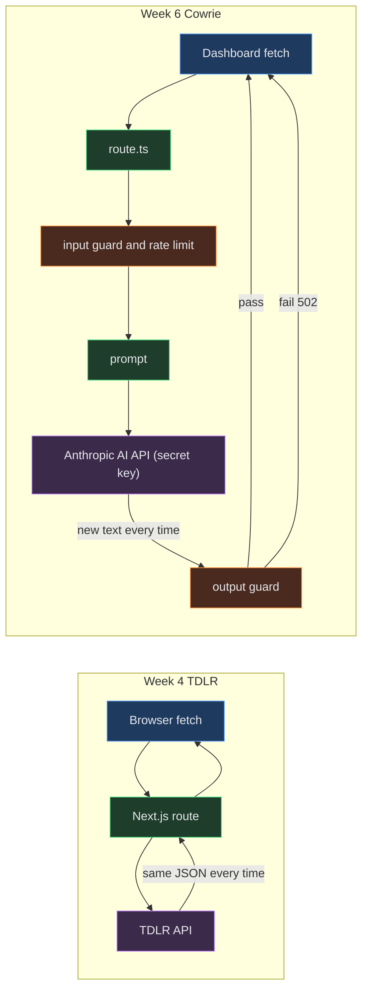
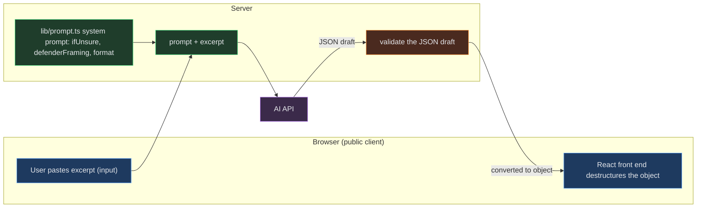
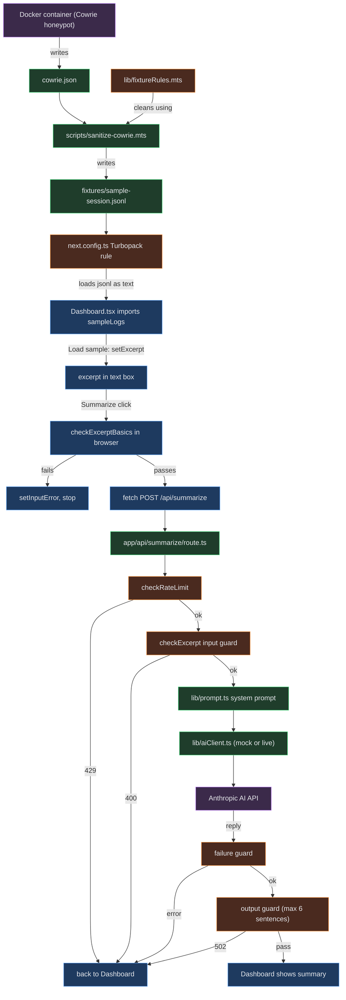

# Week 6 Evidence (Joseph writes everything here)

**Joseph writes every answer. Agents only format, under the rule in CLAUDE.md §6, after Joseph's yes.** Each heading notes when its evidence becomes available. Question text is copied from the course pages (CLAUDE.md §3).

---

## Day 4 Build Plan

- My AI feature:
- Likely failure mode:
- My system prompt (role + rule):
- My three guardrails: input / output / failure:

---

## Checks for Understanding

### Day 1: Calling an AI API in Code
_Status from the Atlas screenshot: Q1 to Q4 saved; Q4 to be updated after Exploration 2 (the AI-call ticket, live mode)._

1. Explain what an 'AI API' is by connecting it to the regular APIs you learned in Week 4. What's the same, and what's different about what comes back?

**1. What's the same (Week 4)**

In Week 4 we created a full stack application where the browser used fetch to send an HTTP request to an application programming interface endpoint on the server side, using Next.js to fetch and receive data. We had no control over the data or how it was managed, because that's the job of the host. We just used the endpoint to ask for something and managed the response and how it was received. Using the TDLR API endpoint, the data was the same shape every time. The endpoint always sent back the same JSON structure, and the same request gave the same answer. That predictability is why we didn't need an output guard.

**2. What's different: the key and cost**

With the actual AI API key, it was different. We had to go to Anthropic, add funds to our account, and create a workspace with a fixed spending limit so that requests sent to the API client wouldn't be abused. The cap was a comprehensive gate protecting key usage. The key itself is a secret that should never be in the browser, because it corresponds to our personal Anthropic account with real funds. The browser is a place the public has access to, so you never want to put secrets, personal information, or even requests or references to that information on the client side. The Next.js server side implementation was crucial here. Making sure the API key was never copied into chats, pushed to the repository, or placed anywhere it would be exposed was essential.

**3. What's different: guarding the request**

Requests were rate limited, and each request had an allocated period of time, so that re-requests outside the allowed amount and time period were handled correctly with a response message and response code. Input needed to be validated, and an indicator needed to show when the live AI was being used. Validation and the steps after it had to be coordinated within the rate limiting window. Limiting the entry point to the server side with strict guards, plus fast checks on both the browser side and the server side, was essential. This also required mock testing, to test the sequential data flow end to end without using real tokens.

**4. What's different: prompt, model and tokens**

Input needed to be passed to the AI using a prompt framework that gave the AI specific instructions on its role, rules, constraints, and how to format its output. The cost for input tokens and output tokens per million needed to be assessed. Output is expected to cost a bit more, and thinking output (the internal steps that help form the response) adds to it by a small factor, depending on the request, the job the AI is doing, and how you frame it. The format instructions set the framework around token usage: you can ask for minimal output or increase it, but that control is essential. Picking a model was also important, one with adequate compute for the job that didn't cost too much per round trip. Anthropic also had an AI SDK available.

**5. What's different: what comes back**

With the AI, what's different is inside the JSON. Because the AI generates text instead of looking it up, the model writes new text each time, so the same input can give different wording, and sometimes it breaks your rules. The prompt shapes the answer, but it's a request, not a guarantee. In our project, the 502 proves that: the AI sent back too many sentences, and the output guard caught it. Tokens are how the text is measured and billed. Knowing the AI is prone to mistakes, output guards on the AI's response were necessary. Because you control the expectation of how the AI and the app should work, you also need clear communication to the user when information can't be validated, the app fails at any point, or actions happen out of sequence. Once input, prompt, output, and response handling were in place, all of the server side responses had to get back to the client side, where the components could show the state changes, the output, token usage, and money spent.

#### Q1 call graph

2. In an AI feature, where does the 'system prompt' live, and what does it do? Connect it to what you learned in Week 2.

**1. Where it lives**

The system prompt lives in lib/prompt.ts and that code runs on the server, not in the browser. That matters because keeping it server side keeps the prompt's contents and control over the model's behavior off the public client, where they could be read or interfered with.

**2. What it does**

ifUnsure is a key value pair that says, if this data looks like anything outside of the usual and fits any one of these particular edge cases or scenarios, then this is how I want you to classify it.

Defender framing assigns the AI a defensive only role. It critiques responses strictly for defense, never gives attack steps, never improves an attacker's commands, and never explains how to evade detection.

Format is a key value pair that says, I've given you all these instructions, these rules, these conditions and scenarios, but at the end of the day I've given you constraints as well. I want you to apply all of these things and bake this recipe and it will come out in this specific format. It's going to be JSON because the JSON needs to be something that can be validated after the draft, and then converted back into an object so that it can be destructured and utilized by the front end with React.

**3. Input vs prompt**

The excerpt the user pastes is the input. The system prompt is an instructional framework that tells the AI how to understand the input, but also how to set constraints on the output.

**4. Week 2 tie**

In Week 2 we learned how to create an effective prompt: how to shape the input and set constraints on the output to get an intended result.

#### Q2 call graph

3. Trace the data flow for 'a user clicks Summarize and sees a summary,' including the AI call. Why does the AI call happen on the back end, not in the browser? Give TWO reasons.

**1. Data flow**

The click stays in the browser and hits the backend route. The backend runs the rate limit, then the input guard, builds the prompt, calls the AI client in mock or live mode, runs the failure guard and the output guard, and sends the summary back to the Dashboard. The AI key never leaves the server.

**2. Why the AI call is on the back end**

First, the AI call happens on the backend or server side because it allows us to keep control over the process, especially when it comes to rate limits and guards. And second, the secret or the API key never leaves the server where it is exposed to the public or could be used without your permission

#### Q3 call graph

4. From Exploration 2: paste the system prompt you wrote. Was the AI's output actually good? How did you judge it? _(available after the AI-call ticket, live mode)_

### Day 2: Tokens, Cost & Rate Limits

1. Explain tokens as the unit of AI cost. Connect it back to what tokens meant in Week 1. Which costs you money: the input, the output, or both?
2. From Exploration 2: roughly what does one call of your feature cost, and what would 1,000 calls cost? Name one thing you could change to lower it. _(after the token-usage ticket, live mode)_
3. A client asks, 'What happens when 100 people use this at the same time?' Explain rate limits in plain terms and one way your app can handle hitting one without crashing.
4. From Exploration 3: what input cap did you add, and why? How does capping protect you (think about a leaked key or a giant input)? _(after the input-guard ticket)_

### Day 3: Guardrails & Reliability

1. Name the three places an AI feature can fail (input, output, failure) and give a realistic example of each for YOUR feature.
2. From Exploration 1: what happened when you threw bad input at your feature? Which failure did you NOT expect? _(after the break-it pass, before the guardrail tickets)_
3. Why is the AI's output always a 'draft' you should guard before showing a user? Name two ways to guard output (one of them involving the system prompt). Connect to Phase 1.
4. For your Week 6 project: state your feature's failure mode and the specific guardrail you'll build for it. Why does that guardrail matter for a real user?

---

## Prompt Log

### Day 1
1. Exploration 2 agent prompt (that you wrote) + your feature's system prompt. _(AI-call ticket)_
2. Exploration 3 before/after: what one system-prompt change did. _(system-prompt-change ticket)_
3. One idea for the AI feature you'll build for this week's project.

### Day 2
1. Token counts (short vs. long input) and your cost estimate. _(token-usage ticket, live mode)_
2. Exploration 3 prompts + what you capped and how errors are handled. _(input-guard + failure tickets)_
3. One cost/limit consideration for the feature you'll build this week.

### Day 3
1. Your feature's failure modes from Exploration 1 (your break-it list). _(break-it pass)_
2. Exploration 2 + 3 prompts + which guardrails you added and what they caught. _(guardrail tickets)_
3. Week 6 project one-liner: your AI feature + its failure mode + your main guardrail.

### Agent mistake caught
_(any ticket: an approved verifier FAIL, or something you caught in a diff)_

---

## Explained

### Data flow, including the AI call
_(after the AI-call ticket; the README diagram is a builder draft you review)_

### Failure mode + guardrail
_(after the guardrail tickets; main failure mode is prompt injection, backstop is the Zod check, per CLAUDE.md D14)_

### Cost
_(after the token-usage ticket, live mode)_

### Govern
1. Where did you use AI?
2. What did you check?
3. What would you tell a user?

---

## Reflection
