<h1 align="center">Prompt Log</h1>

<b>Cowrie AI Log Summarizer</b> · Week 6 and Week 7 · Claude Code

---

## Legend

🟦 Entry (<code>app/layout.tsx</code>, <code>app/page.tsx</code>) 
🟩 UI (<code>app/_components/Dashboard.tsx</code>, <code>app/_components/Header.tsx</code>, <code>app/_components/Footer.tsx</code>) 
🟥 Server (<code>app/api/summarize/route.ts</code>, <code>lib/aiClient.ts</code>, <code>lib/mockAiClient.ts</code>, <code>lib/liveAiClient.ts</code>, <code>lib/prompt.ts</code>, <code>lib/inputGuard.ts</code>, <code>lib/outputGuard.ts</code>, <code>lib/aiFailure.ts</code>, <code>lib/rateLimit.ts</code>, <code>lib/retryAfter.ts</code>, <code>lib/cost.ts</code>, <code>lib/aiMode.ts</code>, <code>lib/redactIps.ts</code>) 
⬛ Database (<code>prisma/schema.prisma</code>, <code>prisma.config.ts</code>, <code>prisma/migrations/</code>, <code>lib/runStore.ts</code>, <code>lib/prismaRunStore.ts</code>, Neon) 
🟫 Honeypot (Cowrie in Docker, <code>scripts/sanitize-cowrie.mts</code>, <code>lib/fixtureRules.mts</code>, <code>fixtures/sample-session.jsonl</code>) 
🟧 Style (<code>app/globals.css</code>, <code>app/page.module.css</code>) 
🟪 Tools (<code>next.config.ts</code>, <code>tsconfig.json</code>, <code>eslint.config.mjs</code>, <code>.github/workflows/ci.yml</code>, <code>lab/openshell/policy.yaml</code>, <code>lab/openshell/Dockerfile</code>, <code>.claude/agents/verifier.md</code>) 
🟨 Dependencies (<code>package.json</code>, <code>package-lock.json</code>)

---

## Project info

<table>
  <tr><th align="left">Field</th><th align="left">Details</th></tr>
  <tr><td><b>One liner</b></td><td>Defensive learning project: a local SSH honeypot plus an AI that summarizes attacker behavior for defenders.</td></tr>
  <tr><td><b>Privacy</b></td><td>Cowrie stays local and is never exposed to the internet; the public site uses sanitized sample logs only (allowlisted fields, documentation IPs, reserved domains); only the capped excerpt (4,000 characters) goes to the AI API; saved summaries replace attacker IPs with "attacker IP" and the raw log is never stored</td></tr>
  <tr><td><b>Tools</b></td><td>Claude Code (model per entry; TBD where no co-author line names it) · Docker Desktop · OpenShell 0.1.6 sandbox (Week 7)</td></tr>
</table>

---

## Entry 1 · (no issue) Cowrie honeypot in Docker

*Oct 24 · TBD (no commit)*

<table>
  <tr><th align="left">Field</th><th align="left">Details</th></tr>
  <tr><td><b>Tool</b></td><td>TBD</td></tr>
  <tr><td><b>Asked</b></td><td>TBD</td></tr>
  <tr><td><b>Context</b></td><td>
    <ul>
      <li><code>CLAUDE.md</code> §5 Current state</li>
    </ul>
  </td></tr>
  <tr><td><b>Changed</b></td><td>
    No repo files. Docker state on the Mac
    <ul>
      <li>🟫 image <code>cowrie/cowrie:latest</code> pulled (ID <code>69e3317c6ecf</code>)</li>
      <li>🟫 container <code>cowrie</code> running · Cowrie 3.1.3, default config, JSON logging, Telnet off</li>
    </ul>
  </td></tr>
  <tr><td><b>Decision</b></td><td>n/a (setup, no code)</td></tr>
  <tr><td><b>Verified</b></td><td>
    <ul>
      <li>Oct 24, by 14:13 CT · Docker Desktop 4.96.3 on Apple Silicon, engine running</li>
      <li>Oct 24, by 14:13 CT · container log says "Ready to accept SSH connections" on port 2222 inside the container</li>
    </ul>
  </td></tr>
  <tr><td><b>Commit</b></td><td>none</td></tr>
  <tr><td><b>PIOF and what differed</b></td><td>
    <ul>
      <li>Purpose: a local SSH honeypot that records sessions to a JSON log</li>
      <li>Input: SSH sessions</li>
      <li>Output: <code>cowrie.json</code> events</li>
      <li>Flow: SSH client → container port 2222 → Cowrie 3.1.3 → <code>var/log/cowrie/cowrie.json</code></li>
      <li>What differed: found later in #9, the container had no host port, so the Mac could not reach it (Entry 8)</li>
    </ul>
  </td></tr>
  <tr><td><b>Reflection</b></td><td>See EVIDENCE.md</td></tr>
  <tr><td><b>Explained</b></td><td>TBD (Joseph writes)</td></tr>
</table>

### Entry 1 call graph

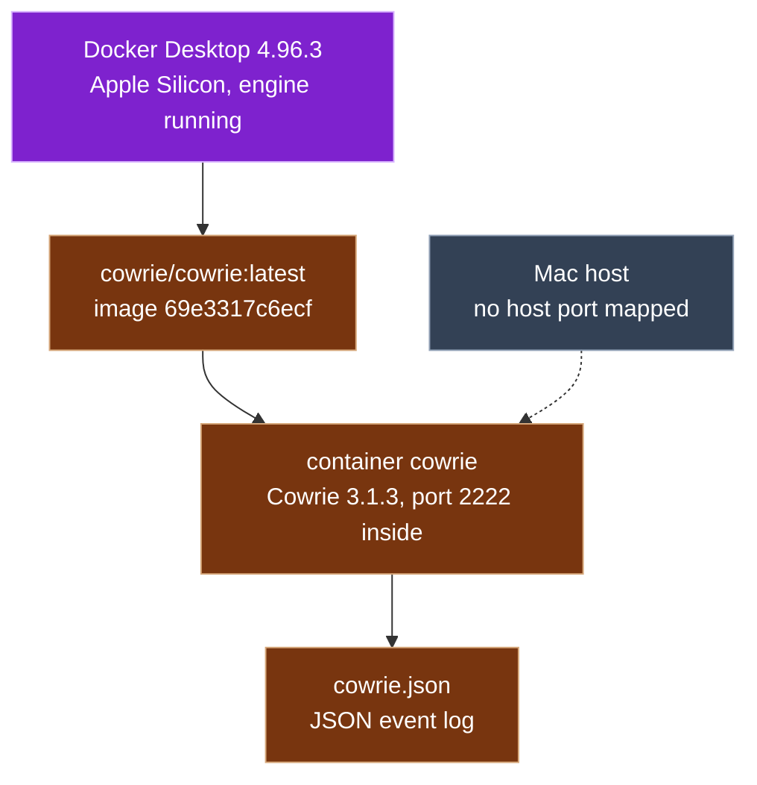

---

## Entry 2 · #2 Scaffold + loop rehearsal

*Oct 25 · TBD to 00:07 CT (commit)*

<table>
  <tr><th align="left">Field</th><th align="left">Details</th></tr>
  <tr><td><b>Tool</b></td><td>Claude Code · model TBD</td></tr>
  <tr><td><b>Asked</b></td><td>Work ticket #2 (Ticket 0): scaffold the Next.js app, <code>AI_MODE</code> defaults to mock, README opening line and boundaries, run the loop rehearsal. Don't commit. Exact prompt text TBD</td></tr>
  <tr><td><b>Context</b></td><td>
    <ul>
      <li><code>CLAUDE.md</code> (D1, D9, D10, D11)</li>
      <li>issue #2</li>
      <li><code>docs/spec.md</code></li>
      <li><code>VERIFIER_PROMPT.md</code></li>
    </ul>
  </td></tr>
  <tr><td><b>Changed</b></td><td>
    28 new files
    <ul>
      <li>🟦 <code>app/layout.tsx</code>, <code>app/page.tsx</code> (new)</li>
      <li>🟧 <code>app/globals.css</code>, <code>app/page.module.css</code> (new)</li>
      <li>🟥 <code>lib/aiMode.ts</code>, <code>lib/aiMode.test.ts</code> (new)</li>
      <li>🟪 <code>next.config.ts</code>, <code>tsconfig.json</code>, <code>eslint.config.mjs</code> (new)</li>
      <li>🟨 <code>package.json</code>, <code>package-lock.json</code> (new) · Next.js 16.4.3, React 19.3, Vitest 5.0.5, <code>@types/node</code> ^22</li>
      <li><code>.gitignore</code>, <code>.env.example</code>, <code>README.md</code>, <code>CLAUDE.md</code>, <code>EVIDENCE.md</code>, <code>GLOSSARY.md</code>, <code>REVIEW.md</code>, <code>VERIFIER_PROMPT.md</code>, <code>AGENTS.md</code>, <code>.claude/progress.txt</code>, <code>docs/spec.md</code>, <code>app/favicon.ico</code>, <code>public/*.svg</code> (new)</li>
    </ul>
  </td></tr>
  <tr><td><b>Decision</b></td><td>accepted</td></tr>
  <tr><td><b>Verified</b></td><td>
    <ul>
      <li>TBD · typecheck, lint and 3 tests passed</li>
      <li>TBD · <code>npm run dev</code> served the placeholder page</li>
      <li>TBD · verifier: 8 PASS / 4 FAIL (N/A not counted)</li>
      <li>TBD · fix pass: <code>.gitignore</code> ignores <code>.claude/*</code> except <code>.claude/progress.txt</code> (F1); <code>cacheComponents</code> and <code>partialPrefetching</code> confirmed as written by <code>create-next-app</code> (F2); <code>REVIEW_LOOP.md</code> moved to <code>context/</code> (F3)</li>
    </ul>
  </td></tr>
  <tr><td><b>Commit</b></td><td><code>7f2f9e3</code> Ticket 00: scaffold Next.js app, AI_MODE mock default, README boundaries, review fixes</td></tr>
  <tr><td><b>PIOF and what differed</b></td><td>
    <ul>
      <li>Purpose: a running Next.js app and a proven builder → verifier → Joseph handoff</li>
      <li>Input: none (scaffold defaults); <code>AI_MODE</code> from the server env</li>
      <li>Output: the placeholder page; <code>getAiMode()</code> returns <code>mock</code> unless <code>AI_MODE</code> is exactly <code>live</code></li>
      <li>Flow: <code>npm run dev</code> → <code>next</code> → 🟦 <code>app/layout.tsx</code> → 🟦 <code>app/page.tsx</code> → Browser</li>
      <li>What differed: the app was scaffolded in the scratchpad with git off, then copied in; <code>typecheck</code> runs <code>next typegen</code> first because <code>LayoutProps</code> comes from generated route types</li>
    </ul>
  </td></tr>
  <tr><td><b>Reflection</b></td><td>See EVIDENCE.md</td></tr>
  <tr><td><b>Explained</b></td><td>TBD (Joseph writes)</td></tr>
</table>

### Entry 2 call graph

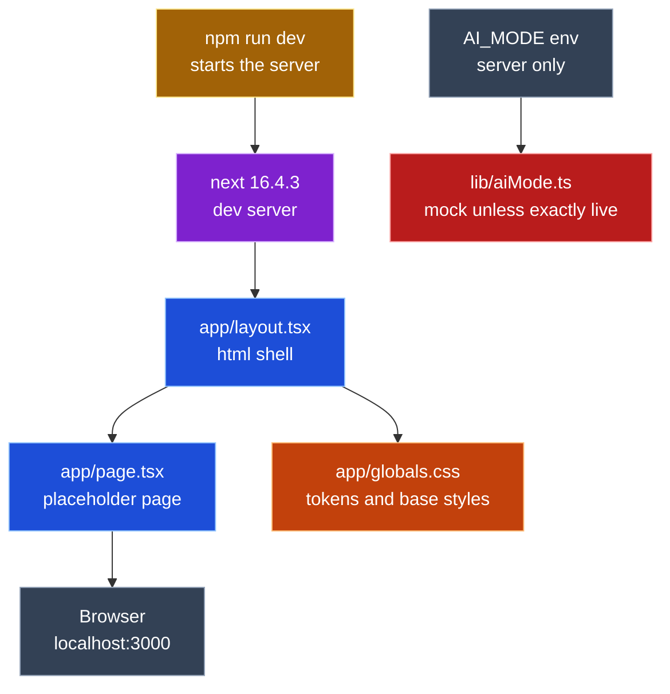

---

## Entry 3 · #2 Verifier becomes a subagent

*Oct 25 · TBD to 00:21 CT (commit)*

<table>
  <tr><th align="left">Field</th><th align="left">Details</th></tr>
  <tr><td><b>Tool</b></td><td>Claude Code · model TBD</td></tr>
  <tr><td><b>Asked</b></td><td>Switch the verifier from a second session to a subagent (D10 revised by Joseph, Oct 25). Exact prompt text TBD</td></tr>
  <tr><td><b>Context</b></td><td>
    <ul>
      <li><code>CLAUDE.md</code> (D10, §9)</li>
      <li><code>VERIFIER_PROMPT.md</code></li>
    </ul>
  </td></tr>
  <tr><td><b>Changed</b></td><td>
    1 new file, 2 edited
    <ul>
      <li>🟪 <code>.claude/agents/verifier.md</code> (new)</li>
      <li><code>.gitignore</code> (modified)</li>
      <li><code>CLAUDE.md</code> (modified)</li>
    </ul>
  </td></tr>
  <tr><td><b>Decision</b></td><td>accepted</td></tr>
  <tr><td><b>Verified</b></td><td>
    <ul>
      <li>TBD</li>
    </ul>
  </td></tr>
  <tr><td><b>Commit</b></td><td><code>3cf3be7</code> Switch verifier to subagent</td></tr>
  <tr><td><b>PIOF and what differed</b></td><td>
    <ul>
      <li>Purpose: the builder calls one verifier with a fresh context per ticket</li>
      <li>Input: the ticket number</li>
      <li>Output: one batched <code>REVIEW.md</code> ending with <code>── REVIEW DONE: n PASS / n FAIL ──</code></li>
      <li>Flow: builder → <code>verifier</code> subagent → <code>git status</code>, <code>git diff</code>, checks 1 to 12 → <code>REVIEW.md</code> → Joseph</li>
      <li>What differed: Ticket 0 planned two sessions; the loop now runs in one session with a subagent</li>
    </ul>
  </td></tr>
  <tr><td><b>Reflection</b></td><td>See EVIDENCE.md</td></tr>
  <tr><td><b>Explained</b></td><td>TBD (Joseph writes)</td></tr>
</table>

### Entry 3 call graph

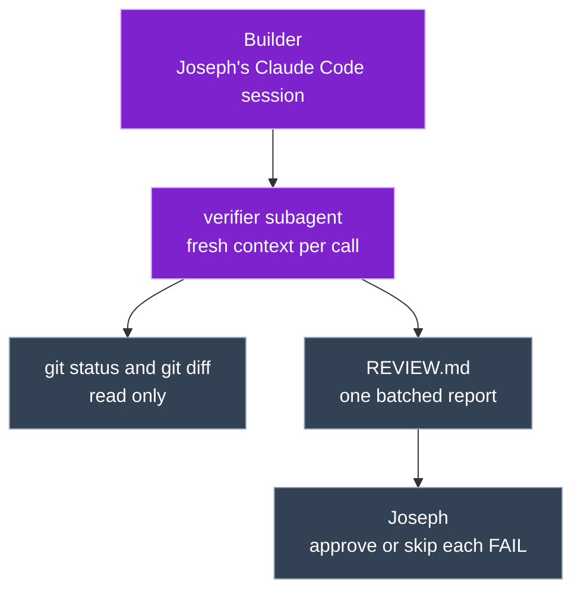

---

## Entry 4 · #3 Mock tracer bullet

*Oct 25 · TBD to 12:56 CT (commit)*

<table>
  <tr><th align="left">Field</th><th align="left">Details</th></tr>
  <tr><td><b>Tool</b></td><td>Claude Code · claude-opus-5-5</td></tr>
  <tr><td><b>Asked</b></td><td>Work ticket #3. Don't commit. (D10 loop prompt; exact text TBD)</td></tr>
  <tr><td><b>Context</b></td><td>
    <ul>
      <li><code>CLAUDE.md</code> (D2, D9, D13)</li>
      <li>issue #3</li>
      <li><code>context/cowrie_summarizer_ui_sample.html</code> (visual reference)</li>
    </ul>
  </td></tr>
  <tr><td><b>Changed</b></td><td>
    7 new files, 8 edited
    <ul>
      <li>🟩 <code>app/_components/Dashboard.tsx</code>, <code>Header.tsx</code>, <code>Footer.tsx</code> (new)</li>
      <li>🟥 <code>app/api/summarize/route.ts</code>, <code>route.test.ts</code> (new)</li>
      <li>🟥 <code>lib/aiClient.ts</code>, <code>lib/mockAiClient.ts</code> (new)</li>
      <li>🟦 <code>app/layout.tsx</code>, <code>app/page.tsx</code> (modified)</li>
      <li>🟧 <code>app/globals.css</code>, <code>app/page.module.css</code> (modified)</li>
      <li>🟪 <code>.claude/agents/verifier.md</code> (modified) · adds runtime checks R1 to R6</li>
      <li><code>CLAUDE.md</code>, <code>.claude/progress.txt</code>, <code>REVIEW.md</code> (modified)</li>
    </ul>
  </td></tr>
  <tr><td><b>Decision</b></td><td>accepted</td></tr>
  <tr><td><b>Verified</b></td><td>
    <ul>
      <li>TBD · typecheck, lint, build and 7 tests passed</li>
      <li>TBD · dev server <code>curl</code> returned the contract body with <code>mode: "mock"</code> despite <code>"mode":"live"</code> in the request body</li>
      <li>TBD · page HTML had all four pills and the footer</li>
      <li>TBD · verifier: 18 PASS / 1 FAIL, R1 to R6 green; the FAIL: the Session state file list left out <code>verifier.md</code> and <code>REVIEW.md</code></li>
    </ul>
  </td></tr>
  <tr><td><b>Commit</b></td><td><code>fd81399</code> Ticket #3: mock tracer bullet (dashboard port, summarize route, mock AI client)</td></tr>
  <tr><td><b>PIOF and what differed</b></td><td>
    <ul>
      <li>Purpose: prove browser → route → AI seam → screen end to end with no real AI call</li>
      <li>Input: <code>{ excerpt }</code> posted from the dashboard</li>
      <li>Output: <code>{ summary, threatLabel, mode, usage, costUsd }</code> from the mock (<code>costUsd</code> fixed at 0 until #5)</li>
      <li>Flow: 🟩 <code>Dashboard.tsx</code> → POST → 🟥 <code>route.ts</code> → 🟥 <code>aiClient.ts</code> → 🟥 <code>mockAiClient.ts</code> → 🟩 <code>Dashboard.tsx</code></li>
      <li>What differed: Geist Mono dropped so Geist is the one font; <code>ModePill</code> calls <code>await connection()</code> inside <code>&lt;Suspense&gt;</code>, as Cache Components requires to read env at request time</li>
    </ul>
  </td></tr>
  <tr><td><b>Reflection</b></td><td>See EVIDENCE.md</td></tr>
  <tr><td><b>Explained</b></td><td>TBD (Joseph writes)</td></tr>
</table>

### Entry 4 call graph

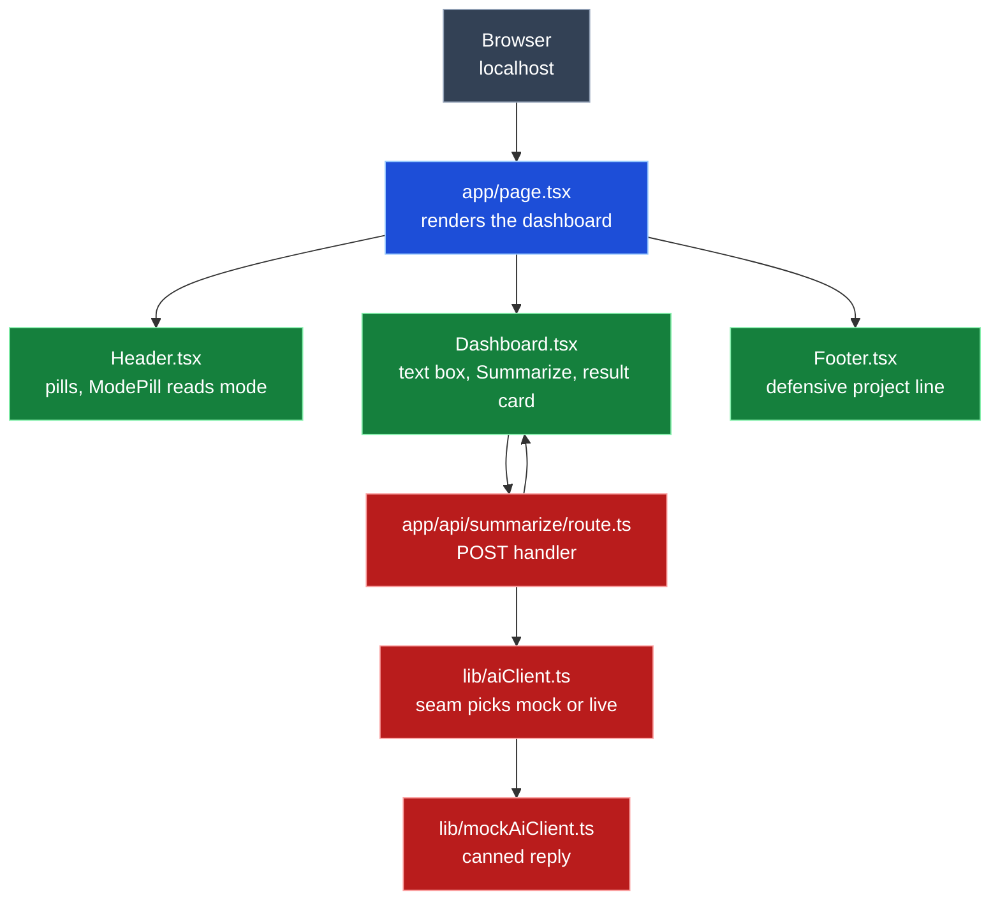

---

## Entry 5 · #5 Live API call + v1 system prompt

*Oct 25 · TBD to 19:16 CT (commit)*

<table>
  <tr><th align="left">Field</th><th align="left">Details</th></tr>
  <tr><td><b>Tool</b></td><td>Claude Code · model TBD</td></tr>
  <tr><td><b>Asked</b></td><td>Work ticket #5. Don't commit. The builder stops and asks for the system prompt, then pastes Joseph's wording word for word (D12). Exact prompt text TBD</td></tr>
  <tr><td><b>Context</b></td><td>
    <ul>
      <li><code>CLAUDE.md</code> (D4, D6, D12, D13)</li>
      <li>issue #5</li>
    </ul>
  </td></tr>
  <tr><td><b>Changed</b></td><td>
    5 new files, 10 edited
    <ul>
      <li>🟥 <code>lib/liveAiClient.ts</code> (new) · <code>claude-haiku-5-5</code>, effort <code>low</code>, <code>max_tokens</code> 2,048, timeout 8,000 ms, 0 retries</li>
      <li>🟥 <code>lib/prompt.ts</code>, <code>lib/prompt.test.ts</code> (new) · Joseph's v1 prompt, <code>buildUserMessage</code>, <code>neutralizeExcerptTags</code></li>
      <li>🟥 <code>lib/cost.ts</code>, <code>lib/cost.test.ts</code> (new) · $0.10 in / $0.50 out per 1M, price date 2026-10-06</li>
      <li>🟥 <code>app/api/summarize/route.ts</code>, <code>route.test.ts</code>, <code>lib/aiClient.ts</code> (modified)</li>
      <li>🟩 <code>app/_components/Dashboard.tsx</code> (modified) · cost notes</li>
      <li>🟧 <code>app/page.module.css</code> (modified)</li>
      <li>🟨 <code>package.json</code>, <code>package-lock.json</code> (modified) · <code>@anthropic-ai/sdk</code> ^1.3.0</li>
      <li><code>CLAUDE.md</code>, <code>.claude/progress.txt</code>, <code>REVIEW.md</code> (modified)</li>
    </ul>
  </td></tr>
  <tr><td><b>Decision</b></td><td>accepted</td></tr>
  <tr><td><b>Verified</b></td><td>
    <ul>
      <li>TBD · typecheck, lint and 13 tests passed</li>
      <li>TBD · verifier: 28 PASS / 1 FAIL (F1: a <code>&lt;/log_excerpt&gt;</code> inside the excerpt could close the wrapper tag early)</li>
      <li>TBD · Joseph approved F1 option A; 17 tests passed</li>
      <li>TBD · verifier re-check: 29 PASS / 0 FAIL, R1 to R6 green</li>
    </ul>
  </td></tr>
  <tr><td><b>Commit</b></td><td><code>7aa9122</code> Ticket #5: live Haiku 5.5 client, Joseph's v1 system prompt, cost notes, excerpt tag escaping</td></tr>
  <tr><td><b>PIOF and what differed</b></td><td>
    <ul>
      <li>Purpose: the real AI call, behind the same seam as the mock</li>
      <li>Input: the excerpt, wrapped in <code>&lt;log_excerpt&gt;</code> tags; the key from <code>process.env.ANTHROPIC_API_KEY</code> only</li>
      <li>Output: reply text, stop reason and <code>usage</code>; the route computes <code>costUsd</code></li>
      <li>Flow: 🟥 <code>route.ts</code> → 🟥 <code>prompt.ts</code> → 🟥 <code>aiClient.ts</code> → 🟥 <code>liveAiClient.ts</code> → Anthropic API → 🟥 <code>cost.ts</code> → 🟩 <code>Dashboard.tsx</code></li>
      <li>What differed: the verifier found the tag breakout; the fix escapes the brackets of opening or closing <code>log_excerpt</code> tags and leaves the prompt wording untouched</li>
    </ul>
  </td></tr>
  <tr><td><b>Reflection</b></td><td>See EVIDENCE.md</td></tr>
  <tr><td><b>Explained</b></td><td>TBD (Joseph writes)</td></tr>
</table>

### Entry 5 call graph

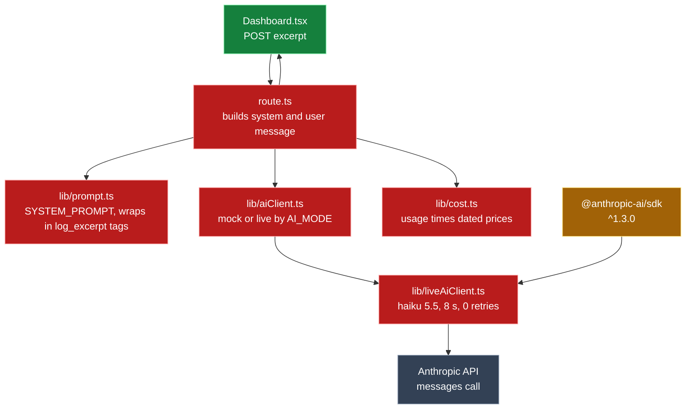

---

## Entry 6 · #5 First live runs, C9 deferred

*Oct 26 · TBD to 16:34 CT (commit)*

<table>
  <tr><th align="left">Field</th><th align="left">Details</th></tr>
  <tr><td><b>Tool</b></td><td>Claude Code · claude-opus-5-5</td></tr>
  <tr><td><b>Asked</b></td><td>Record Joseph's live runs, defer the prompt change (C9) until #10, switch back to mock. Exact prompt text TBD</td></tr>
  <tr><td><b>Context</b></td><td>
    <ul>
      <li><code>CLAUDE.md</code> (D4, D9)</li>
      <li>issue #5</li>
      <li>Joseph's Console screenshot and DevTools response</li>
    </ul>
  </td></tr>
  <tr><td><b>Changed</b></td><td>
    3 edited, no code
    <ul>
      <li><code>CLAUDE.md</code>, <code>.claude/progress.txt</code>, <code>REVIEW.md</code> (modified)</li>
    </ul>
  </td></tr>
  <tr><td><b>Decision</b></td><td>accepted · C9 deferred until the #10 Zod results are in</td></tr>
  <tr><td><b>Verified</b></td><td>
    <ul>
      <li>TBD · run 1 (2-line excerpt, root/123456 login + <code>uname -a</code>): Live AI pill, 520 in / 147 out tokens, $0.000125, label medium, 3 sentences</li>
      <li>TBD · Console workspace "NC Build", 1 API key, spend limit $5.00 (Joseph's screenshot)</li>
      <li>TBD · run 2: <code>mode: "live"</code> in DevTools, 520 in / 179 out, $0.0001415, label medium, summary about 530 characters</li>
      <li>TBD · verifier: 27 PASS / 1 FAIL (stale Session state, no code issue)</li>
    </ul>
  </td></tr>
  <tr><td><b>Commit</b></td><td><code>5914b7d</code> Ticket #5: record live runs, defer prompt change (C9) until #10, back to mock</td></tr>
  <tr><td><b>PIOF and what differed</b></td><td>
    <ul>
      <li>Purpose: prove one real call with a spend limit in place</li>
      <li>Input: a 2-line Cowrie excerpt</li>
      <li>Output: a live summary with nonzero token counts and a measured cost</li>
      <li>Flow: Dashboard → route → <code>liveAiClient.ts</code> → Anthropic → <code>cost.ts</code> → result card</li>
      <li>What differed: run 2's summary was near the 600 cap and nothing enforced it before #10, so the prompt change waited</li>
    </ul>
  </td></tr>
  <tr><td><b>Reflection</b></td><td>See EVIDENCE.md</td></tr>
  <tr><td><b>Explained</b></td><td>TBD (Joseph writes)</td></tr>
</table>

### Entry 6 call graph

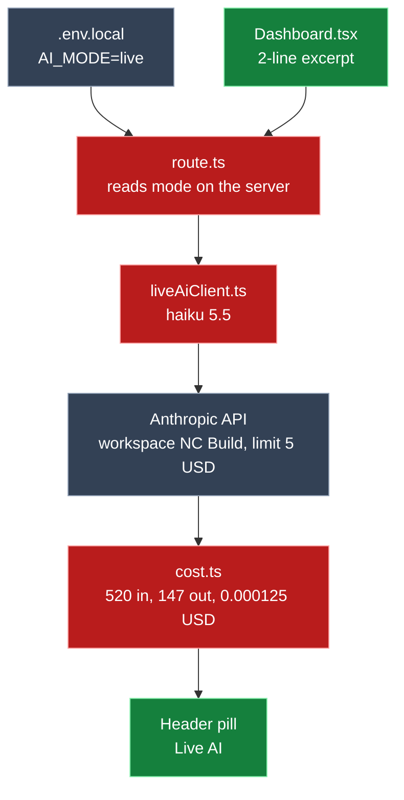

---

## Entry 7 · #8 Input guard + upload

*Oct 26 · TBD to 17:12 CT (commit)*

<table>
  <tr><th align="left">Field</th><th align="left">Details</th></tr>
  <tr><td><b>Tool</b></td><td>Claude Code · claude-opus-5-5</td></tr>
  <tr><td><b>Asked</b></td><td>Work ticket #8. Don't commit. (D10 loop prompt; exact text TBD)</td></tr>
  <tr><td><b>Context</b></td><td>
    <ul>
      <li><code>CLAUDE.md</code> (D6)</li>
      <li>issue #8</li>
      <li><code>context/cowrie_summarizer_ui_sample.html</code> (dropzone)</li>
    </ul>
  </td></tr>
  <tr><td><b>Changed</b></td><td>
    2 new files, 7 edited
    <ul>
      <li>🟥 <code>lib/inputGuard.ts</code>, <code>lib/inputGuard.test.ts</code> (new)</li>
      <li>🟥 <code>app/api/summarize/route.ts</code>, <code>route.test.ts</code> (modified)</li>
      <li>🟩 <code>app/_components/Dashboard.tsx</code> (modified) · dropzone, 50 KB check</li>
      <li>🟧 <code>app/page.module.css</code> (modified)</li>
      <li><code>CLAUDE.md</code>, <code>.claude/progress.txt</code>, <code>REVIEW.md</code> (modified)</li>
    </ul>
  </td></tr>
  <tr><td><b>Decision</b></td><td>accepted</td></tr>
  <tr><td><b>Verified</b></td><td>
    <ul>
      <li>TBD · typecheck, lint and 39 tests passed</li>
      <li>TBD · verifier: 27 PASS / 0 FAIL, R1 to R6 green</li>
    </ul>
  </td></tr>
  <tr><td><b>Commit</b></td><td><code>65216c5</code> Ticket #8: input guard (empty, 4,000 cap, Cowrie check) + upload</td></tr>
  <tr><td><b>PIOF and what differed</b></td><td>
    <ul>
      <li>Purpose: reject bad input on the server before any AI call</li>
      <li>Input: the pasted or uploaded excerpt</li>
      <li>Output: 400 <code>{ error }</code> for empty, over 4,000 characters (with the count) or non-Cowrie text; otherwise the AI path</li>
      <li>Flow: 🟩 <code>Dashboard.tsx</code> (<code>checkExcerptBasics</code> for fast feedback) → 🟥 <code>route.ts</code> → 🟥 <code>checkExcerpt</code> → AI call</li>
      <li>What differed: a body that isn't JSON or has no string <code>excerpt</code> is now treated as empty (was a 500); the length and upload message wording is the builder's</li>
    </ul>
  </td></tr>
  <tr><td><b>Reflection</b></td><td>See EVIDENCE.md</td></tr>
  <tr><td><b>Explained</b></td><td>TBD (Joseph writes)</td></tr>
</table>

### Entry 7 call graph

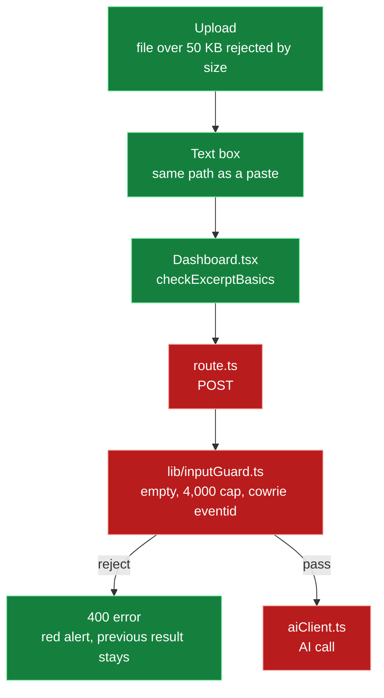

---

## Entry 8 · #9 Log capture + sanitized sample fixture

*Oct 27 · TBD to 06:54 CT (commit)*

<table>
  <tr><th align="left">Field</th><th align="left">Details</th></tr>
  <tr><td><b>Tool</b></td><td>Claude Code · model TBD</td></tr>
  <tr><td><b>Asked</b></td><td>Work ticket #9. Don't commit. Every <code>docker</code> command only after Joseph's OK. Exact prompt text TBD</td></tr>
  <tr><td><b>Context</b></td><td>
    <ul>
      <li><code>CLAUDE.md</code> (D3, D14)</li>
      <li>issue #9</li>
    </ul>
  </td></tr>
  <tr><td><b>Changed</b></td><td>
    5 new files (plus the bundle files in Entry 9), 3 edited
    <ul>
      <li>🟫 <code>scripts/sanitize-cowrie.mts</code> (new)</li>
      <li>🟫 <code>lib/fixtureRules.mts</code>, <code>lib/fixtureRules.test.ts</code> (new)</li>
      <li>🟫 <code>fixtures/sample-session.jsonl</code>, <code>fixtures/sample-session.test.ts</code> (new)</li>
      <li><code>CLAUDE.md</code>, <code>.claude/progress.txt</code>, <code>REVIEW.md</code> (modified)</li>
    </ul>
    Docker: Joseph created <code>cowrie-local</code> with <code>-p 127.0.0.1:2222:2222</code>
  </td></tr>
  <tr><td><b>Decision</b></td><td>accepted</td></tr>
  <tr><td><b>Verified</b></td><td>
    <ul>
      <li>TBD · original <code>cowrie</code> container: stopped, PortBindings <code>{}</code>, logs in an anonymous volume at <code>/cowrie/cowrie-git/var</code>, <code>cowrie.json</code> was 0 bytes</li>
      <li>TBD · first fixture attempt rejected by the sanitizer for a non-default password; raw copy deleted, container recreated</li>
      <li>TBD · fixture from Joseph's fresh <code>cowrie-local</code> session: 11 events, 1,387 characters</li>
      <li>TBD · 82 tests passed</li>
      <li>TBD · verifier: 29 PASS / 0 FAIL, R1 to R6 green</li>
    </ul>
  </td></tr>
  <tr><td><b>Commit</b></td><td><code>809e57b</code> Ticket #9: sanitized Cowrie sample fixture + Load sample logs button</td></tr>
  <tr><td><b>PIOF and what differed</b></td><td>
    <ul>
      <li>Purpose: an authentic Cowrie sample that reveals nothing about Joseph's setup</li>
      <li>Input: the raw <code>cowrie.json</code> copied out with <code>docker cp</code></li>
      <li>Output: <code>fixtures/sample-session.jsonl</code> with allowlisted fields, documentation IPs, reserved domains, default passwords, one fixed date</li>
      <li>Flow: SSH to 127.0.0.1:2222 → <code>cowrie-local</code> → <code>cowrie.json</code> in the volume → <code>docker cp</code> → 🟫 <code>sanitize-cowrie.mts</code> → 🟫 <code>fixtureRules.mts</code> → 🟫 <code>sample-session.jsonl</code></li>
      <li>What differed: the original container had no host port, so a new container was needed; the first sanitizer run rejected a real-looking password</li>
    </ul>
  </td></tr>
  <tr><td><b>Reflection</b></td><td>See EVIDENCE.md</td></tr>
  <tr><td><b>Explained</b></td><td>TBD (Joseph writes)</td></tr>
</table>

### Entry 8 call graph

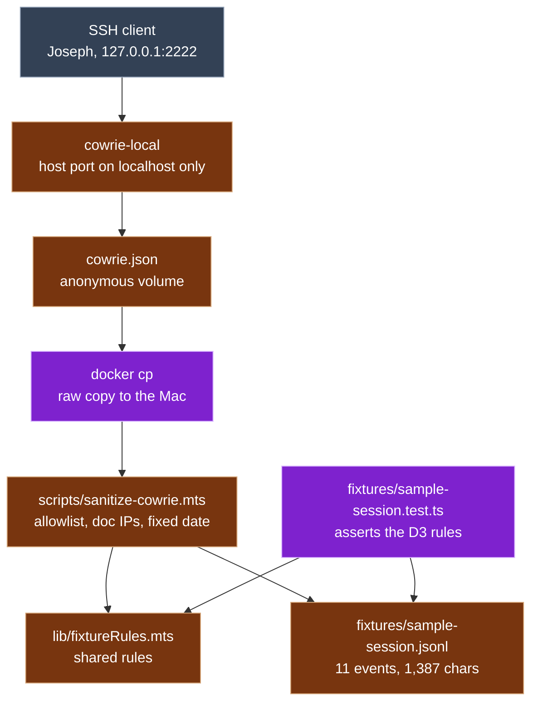

---

## Entry 9 · #9 Turbopack browser bundle + cost note range

*Oct 27 · TBD to 07:00 CT (commit)*

<table>
  <tr><th align="left">Field</th><th align="left">Details</th></tr>
  <tr><td><b>Tool</b></td><td>Claude Code · model TBD</td></tr>
  <tr><td><b>Asked</b></td><td>Part of ticket #9: a "Load sample logs" button that loads the fixture on the client (D3). Then the follow-up: change the cost note to the measured range (option A). Exact prompt text TBD</td></tr>
  <tr><td><b>Context</b></td><td>
    <ul>
      <li><code>CLAUDE.md</code> (D3, D13)</li>
      <li>issue #9</li>
      <li>measured runs from Entry 6</li>
    </ul>
  </td></tr>
  <tr><td><b>Changed</b></td><td>
    1 new file, 6 edited
    <ul>
      <li>🟪 <code>next.config.ts</code> (modified) · Turbopack <code>*.jsonl</code> text rule</li>
      <li>🟪 <code>jsonl.d.ts</code> (new) · type for <code>.jsonl</code> imports</li>
      <li>🟪 <code>tsconfig.json</code> (modified) · <code>allowImportingTsExtensions</code></li>
      <li>🟩 <code>app/_components/Dashboard.tsx</code> (modified) · Load sample logs button; cost note "about $0.0001–$0.0003 per call"</li>
      <li><code>docs/spec.md</code> (modified) · story 48</li>
      <li>🟥 <code>lib/cost.test.ts</code> (modified) · comment only</li>
      <li><code>CLAUDE.md</code>, <code>.claude/progress.txt</code> (modified)</li>
    </ul>
  </td></tr>
  <tr><td><b>Decision</b></td><td>accepted</td></tr>
  <tr><td><b>Verified</b></td><td>
    <ul>
      <li>TBD · dev server (mock, 127.0.0.1:3000) showed the button</li>
      <li>TBD · the fixture text was in a client chunk</li>
      <li>TBD · a fixture POST returned the mock contract</li>
    </ul>
  </td></tr>
  <tr><td><b>Commit</b></td><td>
    <ul>
      <li><code>809e57b</code> Ticket #9: sanitized Cowrie sample fixture + Load sample logs button</li>
      <li><code>acea1da</code> Cost note: show measured $0.0001 to $0.0003 range instead of the $0.0003 estimate</li>
    </ul>
  </td></tr>
  <tr><td><b>PIOF and what differed</b></td><td>
    <ul>
      <li>Purpose: load the sample in the browser so it takes the same path as a paste</li>
      <li>Input: <code>fixtures/sample-session.jsonl</code> imported as text at build time</li>
      <li>Output: the fixture text in the text box; then the same POST, input guard and rate limit</li>
      <li>Flow: 🟫 <code>sample-session.jsonl</code> → 🟪 Turbopack text rule → client chunk → 🟩 Load sample logs → text box → POST → 🟥 <code>route.ts</code></li>
      <li>What differed: the cost note moved from a single $0.0003 estimate to the measured range ($0.000125 and $0.0001415 runs)</li>
    </ul>
  </td></tr>
  <tr><td><b>Reflection</b></td><td>See EVIDENCE.md</td></tr>
  <tr><td><b>Explained</b></td><td>TBD (Joseph writes)</td></tr>
</table>

### Entry 9 call graph

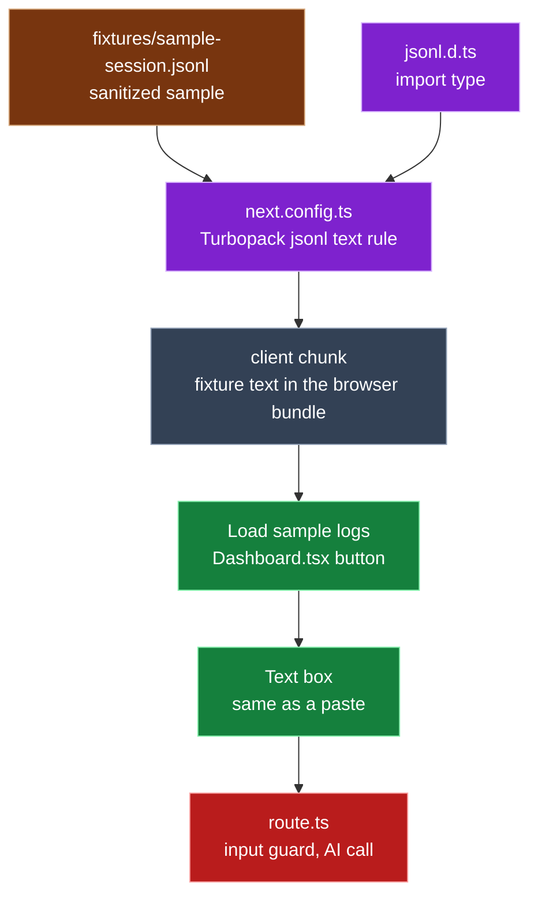

---

## Entry 10 · #10 Output guard, threat badge + failure guard

*Oct 27 · TBD to 07:33 CT (commit)*

<table>
  <tr><th align="left">Field</th><th align="left">Details</th></tr>
  <tr><td><b>Tool</b></td><td>Claude Code · model TBD</td></tr>
  <tr><td><b>Asked</b></td><td>Work ticket #10. Don't commit. (D10 loop prompt; exact text TBD)</td></tr>
  <tr><td><b>Context</b></td><td>
    <ul>
      <li><code>CLAUDE.md</code> (D5, D7, D9, D13)</li>
      <li>issue #10 (#11 merged into it)</li>
    </ul>
  </td></tr>
  <tr><td><b>Changed</b></td><td>
    4 new files, 12 edited
    <ul>
      <li>🟥 <code>lib/outputGuard.ts</code>, <code>lib/outputGuard.test.ts</code> (new)</li>
      <li>🟥 <code>lib/aiFailure.ts</code>, <code>lib/aiFailure.test.ts</code> (new)</li>
      <li>🟥 <code>app/api/summarize/route.ts</code>, <code>route.test.ts</code>, <code>lib/aiClient.ts</code>, <code>lib/liveAiClient.ts</code>, <code>lib/mockAiClient.ts</code> (modified)</li>
      <li>🟩 <code>app/_components/Dashboard.tsx</code> (modified) · failure alert, grey Unknown badge</li>
      <li>🟧 <code>app/page.module.css</code> (modified)</li>
      <li>🟨 <code>package.json</code>, <code>package-lock.json</code> (modified) · <code>zod</code> ^4.6.7 as a direct dependency</li>
      <li><code>CLAUDE.md</code>, <code>.claude/progress.txt</code>, <code>REVIEW.md</code> (modified)</li>
    </ul>
  </td></tr>
  <tr><td><b>Decision</b></td><td>accepted · Joseph approved HTTP 503 for unavailable and auth errors, and the browser-only "Couldn't reach the server" fallback</td></tr>
  <tr><td><b>Verified</b></td><td>
    <ul>
      <li>TBD · typecheck, lint and 118 tests passed</li>
      <li>TBD · verifier: 40 PASS / 0 FAIL (4 N/A), R1 to R6 green</li>
      <li>TBD · fix pass on the advisory: <code>countSentences</code> skips splits after e.g., i.e., etc., vs., approx., incl., cf.; 123 tests passed; not re-verified (touched only the approved item)</li>
    </ul>
  </td></tr>
  <tr><td><b>Commit</b></td><td><code>b2c7a81</code> Ticket #10: Zod output guard, threat badge, failure guard (timeout, 429, 5xx, auth)</td></tr>
  <tr><td><b>PIOF and what differed</b></td><td>
    <ul>
      <li>Purpose: show only validated output, and a friendly message for every failure</li>
      <li>Input: the AI reply (text and stop reason) or a thrown SDK error</li>
      <li>Output: <code>{ summary, threatLabel }</code>, or 502 / 503 / 504 with a safe message; logs carry a code and field + rule only</li>
      <li>Flow: 🟥 <code>route.ts</code> → AI call in try/catch → 🟥 <code>aiFailure.ts</code> (errors) or 🟥 <code>outputGuard.ts</code> (reply) → 🟩 <code>Dashboard.tsx</code></li>
      <li>What differed: mock timeout and rate-limited scenarios throw the SDK's own error classes, so the same mapping runs as live</li>
    </ul>
  </td></tr>
  <tr><td><b>Reflection</b></td><td>See EVIDENCE.md</td></tr>
  <tr><td><b>Explained</b></td><td>TBD (Joseph writes)</td></tr>
</table>

### Entry 10 call graph

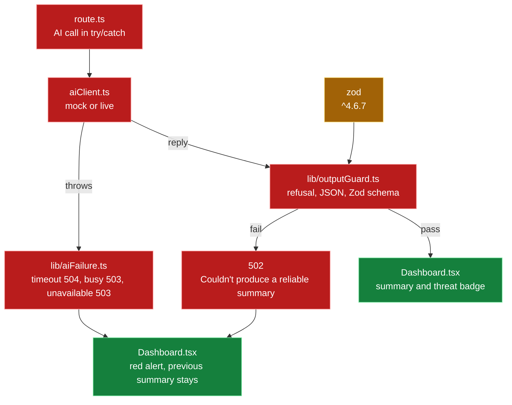

---

## Entry 11 · #12 Rate limit

*Oct 27 · TBD to 12:30 CT (commit)*

<table>
  <tr><th align="left">Field</th><th align="left">Details</th></tr>
  <tr><td><b>Tool</b></td><td>Claude Code · model TBD</td></tr>
  <tr><td><b>Asked</b></td><td>Work ticket #12. Don't commit. (D10 loop prompt; exact text TBD)</td></tr>
  <tr><td><b>Context</b></td><td>
    <ul>
      <li><code>CLAUDE.md</code> (D8)</li>
      <li>issue #12</li>
    </ul>
  </td></tr>
  <tr><td><b>Changed</b></td><td>
    2 new files, 8 edited
    <ul>
      <li>🟥 <code>lib/rateLimit.ts</code>, <code>lib/rateLimit.test.ts</code> (new)</li>
      <li>🟥 <code>app/api/summarize/route.ts</code>, <code>route.test.ts</code> (modified)</li>
      <li>🟩 <code>app/_components/Dashboard.tsx</code> (modified) · amber alert, Summarize disabled for <code>retryAfterSeconds</code></li>
      <li>🟧 <code>app/page.module.css</code> (modified) · <code>.alertRate</code></li>
      <li><code>README.md</code> (modified) · "Rate limit (known limitation)"</li>
      <li><code>CLAUDE.md</code>, <code>.claude/progress.txt</code>, <code>REVIEW.md</code> (modified)</li>
    </ul>
  </td></tr>
  <tr><td><b>Decision</b></td><td>accepted</td></tr>
  <tr><td><b>Verified</b></td><td>
    <ul>
      <li>TBD · typecheck, lint and 142 tests passed</li>
      <li>TBD · verifier (second run; the first stopped when the session ended): 33 PASS / 0 FAIL, R1 to R6 green</li>
      <li>TBD · advisory: on a 429 the dashboard doesn't guard a body that isn't JSON or lacks <code>retryAfterSeconds</code> (Entry 12)</li>
    </ul>
  </td></tr>
  <tr><td><b>Commit</b></td><td><code>7290f90</code> Ticket #12: rate limit, one summary per minute per client (hashed Netlify connection IP, shared bucket fallback)</td></tr>
  <tr><td><b>PIOF and what differed</b></td><td>
    <ul>
      <li>Purpose: one summary per minute per client</li>
      <li>Input: the <code>x-nf-client-connection-ip</code> header only</li>
      <li>Output: 429 <code>{ error, retryAfterSeconds }</code> plus a <code>Retry-After</code> header, or the normal path</li>
      <li>Flow: <code>clientKey</code> → log <code>ipHeaderPresent</code> → <code>checkRateLimit</code> → input guard → <code>takeRateLimit</code> → AI call</li>
      <li>What differed: locally there is no Netlify header, so everyone shares one bucket; that Netlify sends the header is proven only at deploy</li>
    </ul>
  </td></tr>
  <tr><td><b>Reflection</b></td><td>See EVIDENCE.md</td></tr>
  <tr><td><b>Explained</b></td><td>TBD (Joseph writes)</td></tr>
</table>

### Entry 11 call graph

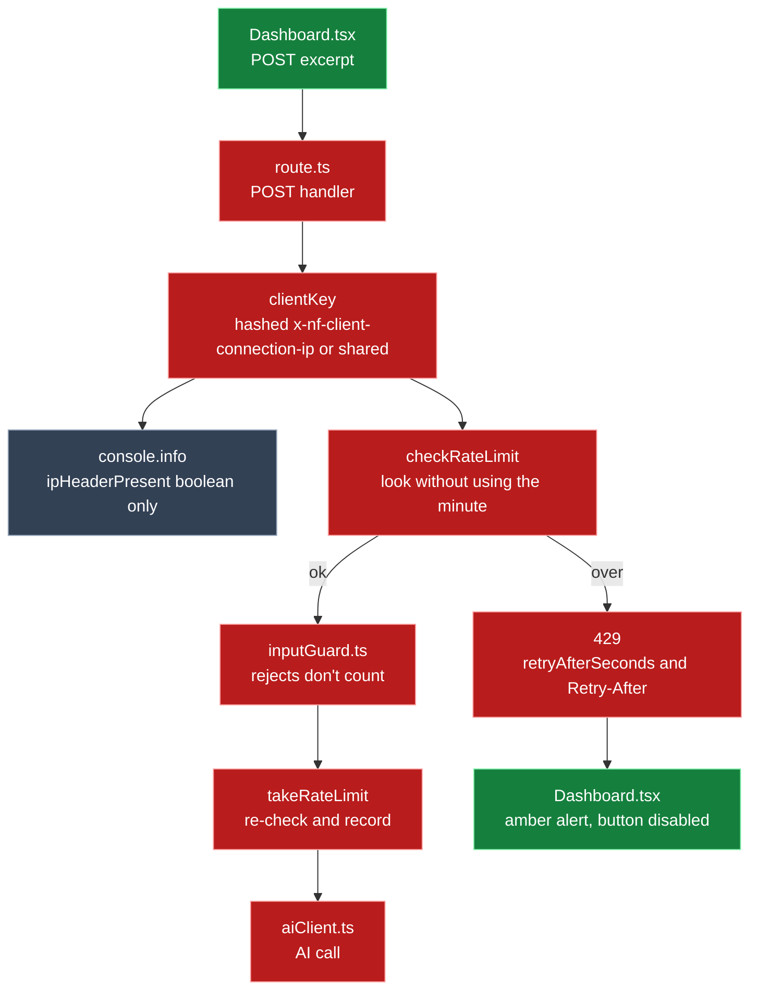

---

## Entry 12 · #12 follow-up Retry-After fallback

*Oct 27 · TBD to 14:16 CT (commit); Session state 14:25 CT*

<table>
  <tr><th align="left">Field</th><th align="left">Details</th></tr>
  <tr><td><b>Tool</b></td><td>Claude Code · model TBD</td></tr>
  <tr><td><b>Asked</b></td><td>Joseph's revision of advisory 1 from the #12 review: guard the 429 body in the dashboard. Exact prompt text TBD</td></tr>
  <tr><td><b>Context</b></td><td>
    <ul>
      <li><code>CLAUDE.md</code> (D8)</li>
      <li><code>REVIEW.md</code> from #12</li>
    </ul>
  </td></tr>
  <tr><td><b>Changed</b></td><td>
    2 new files, 5 edited
    <ul>
      <li>🟥 <code>lib/retryAfter.ts</code>, <code>lib/retryAfter.test.ts</code> (new) · browser-safe, 19 cases</li>
      <li>🟥 <code>lib/rateLimit.ts</code> (modified) · re-exports <code>rateLimitMessage</code></li>
      <li>🟩 <code>app/_components/Dashboard.tsx</code> (modified)</li>
      <li><code>CLAUDE.md</code>, <code>.claude/progress.txt</code>, <code>REVIEW.md</code> (modified)</li>
    </ul>
  </td></tr>
  <tr><td><b>Decision</b></td><td>accepted</td></tr>
  <tr><td><b>Verified</b></td><td>
    <ul>
      <li>TBD · typecheck, lint and 161 tests passed</li>
      <li>TBD · verifier: 40 PASS / 0 FAIL / 1 N/A, R1 to R6 green; a second POST got 429 with <code>Retry-After: 57</code> and a matching body</li>
      <li>TBD · Joseph on screen: amber alert, disabled Summarize, countdown and release all confirmed</li>
    </ul>
  </td></tr>
  <tr><td><b>Commit</b></td><td>
    <ul>
      <li><code>bf39d95</code> #12 follow-up: 429 fallback to Retry-After header, then 60 s, capped at 300 s</li>
      <li><code>47c52eb</code> Session state: #12 follow-up committed as bf39d95, seen on screen; next #5 C9</li>
    </ul>
  </td></tr>
  <tr><td><b>PIOF and what differed</b></td><td>
    <ul>
      <li>Purpose: the wait time never breaks, whatever a 429 body looks like</li>
      <li>Input: the 429 body and its <code>Retry-After</code> header</li>
      <li>Output: whole seconds: the body value if valid, else the header, else 60; always capped at 300</li>
      <li>Flow: 🟩 <code>Dashboard.tsx</code> 429 branch → reads body without throwing → 🟥 <code>readRetryAfter</code> → <code>rateLimitMessage</code> → amber alert and timer</li>
      <li>What differed: <code>rateLimitMessage</code> moved out of <code>rateLimit.ts</code> because that file imports <code>node:crypto</code></li>
    </ul>
  </td></tr>
  <tr><td><b>Reflection</b></td><td>See EVIDENCE.md</td></tr>
  <tr><td><b>Explained</b></td><td>TBD (Joseph writes)</td></tr>
</table>

### Entry 12 call graph

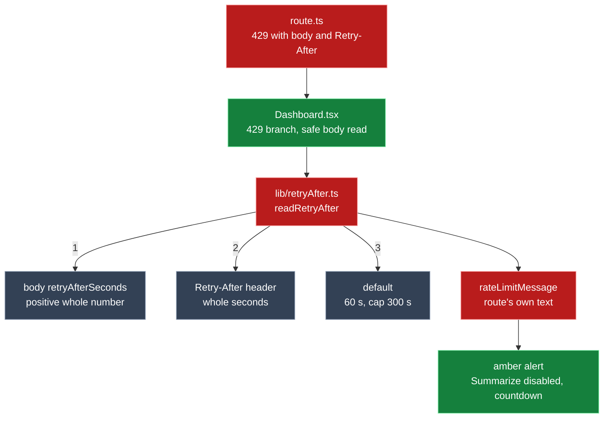

---

## Entry 13 · #5 C9 summary format + prompt v2

*Oct 30 · TBD to 13:58 CT (commit); Session state 14:01 CT*

<table>
  <tr><th align="left">Field</th><th align="left">Details</th></tr>
  <tr><td><b>Tool</b></td><td>Claude Code · model TBD</td></tr>
  <tr><td><b>Asked</b></td><td>Joseph's live runs with the Zod check in place, then his prompt-only change; the builder stops before any wording and pastes Joseph's text word for word (D12). Exact prompt text TBD</td></tr>
  <tr><td><b>Context</b></td><td>
    <ul>
      <li><code>CLAUDE.md</code> (D5, D12, D13, §6 EVIDENCE.md answer format)</li>
      <li>issue #5</li>
      <li><code>lib/prompt.ts</code> v1</li>
    </ul>
  </td></tr>
  <tr><td><b>Changed</b></td><td>
    11 edited
    <ul>
      <li>🟥 <code>lib/prompt.ts</code> (modified) · format part only, Joseph's wording; <code>// v2</code> comment</li>
      <li>🟥 <code>lib/outputGuard.ts</code> (modified) · <code>MAX_SUMMARY_SENTENCES</code> 3 → 6, <code>MAX_SUMMARY_CHARS</code> 600 → 700</li>
      <li>🟥 <code>lib/outputGuard.test.ts</code>, <code>lib/cost.test.ts</code>, <code>lib/liveAiClient.ts</code> (modified)</li>
      <li>🟩 <code>app/_components/Dashboard.tsx</code> (modified) · cost note $0.0001–$0.0008</li>
      <li><code>docs/spec.md</code>, <code>EVIDENCE.md</code> (Day 1 Q1–Q3, formatted only), <code>CLAUDE.md</code>, <code>.claude/progress.txt</code>, <code>REVIEW.md</code> (modified)</li>
    </ul>
  </td></tr>
  <tr><td><b>Decision</b></td><td>accepted · T16 skipped (one combined commit); advisories 1 to 5 approved; Joseph kept the prompt and the 700 cap as is</td></tr>
  <tr><td><b>Verified</b></td><td>
    <ul>
      <li>Oct 28, TBD · live sample runs with v1 failed <code>summary: too_big</code> (677 characters, 4 sentences)</li>
      <li>Oct 28, TBD · after Joseph's 3-sentence format edit: passed Zod (3 sentences, ~430 characters), label high, 1,192 in / 1,216 out, $0.000727</li>
      <li>Oct 30, TBD · another live sample run failed <code>summary: too_many_sentences</code>; Joseph raised the limits to 6 sentences / 700 characters</li>
      <li>Oct 30, TBD · verifier: 37 PASS / 1 FAIL / 7 N/A, R1 to R6 green (T16: the diff isn't prompt-only)</li>
      <li>Oct 30, TBD · 162 tests, typecheck and lint passed; Joseph's browser check passed</li>
    </ul>
  </td></tr>
  <tr><td><b>Commit</b></td><td>
    <ul>
      <li><code>97b276b</code> Ticket #5 C9: summary format to 6 sentences / 700 chars, prompt v2, cost note $0.0001–$0.0008</li>
      <li><code>054330d</code> Session state: #5 C9 committed as 97b276b; next #13 or #14</li>
    </ul>
  </td></tr>
  <tr><td><b>PIOF and what differed</b></td><td>
    <ul>
      <li>Purpose: summaries that pass the output guard on the real sample</li>
      <li>Input: the sample fixture, live mode</li>
      <li>Output: a summary of at most 6 sentences and 700 characters</li>
      <li>Flow: 🟥 <code>prompt.ts</code> (format rule) → Anthropic → 🟥 <code>outputGuard.ts</code> (same limits) → 🟩 <code>Dashboard.tsx</code></li>
      <li>What differed: measured cost reached $0.000727, above the old note, so the note became $0.0001–$0.0008; hidden thinking tokens make up most of the output</li>
    </ul>
  </td></tr>
  <tr><td><b>Reflection</b></td><td>See EVIDENCE.md</td></tr>
  <tr><td><b>Explained</b></td><td>TBD (Joseph writes)</td></tr>
</table>

### Entry 13 call graph

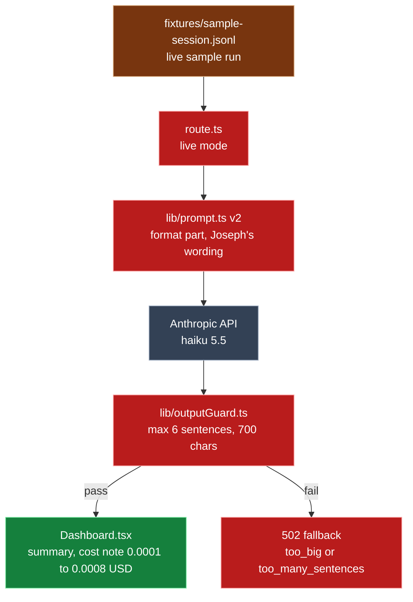

---

## Entry 14 · (no issue) Week 7 Step 0 · the OpenShell pivot

*Oct 30 · TBD to 15:37 CT (commit); policy fix Oct 31 09:23 CT*

<table>
  <tr><th align="left">Field</th><th align="left">Details</th></tr>
  <tr><td><b>Tool</b></td><td>Claude Code · model TBD</td></tr>
  <tr><td><b>Asked</b></td><td>Week 7 Step 0: the upgrade plan, the proven OpenShell guide and lab files, and <code>CLAUDE.md</code> §11. Then allow <code>platform.claude.com</code> for <code>claude</code> in the sandbox policy. Exact prompt text TBD</td></tr>
  <tr><td><b>Context</b></td><td>
    <ul>
      <li><code>CLAUDE.md</code></li>
      <li>OpenShell 0.1.6 tests on Joseph's Mac (Oct 30)</li>
    </ul>
  </td></tr>
  <tr><td><b>Changed</b></td><td>
    10 new files, 5 edited
    <ul>
      <li><code>docs/week7/SPEC.md</code>, <code>HANDOFF.md</code>, <code>OPENSHELL_MAC_GUIDE.md</code>, <code>EVIDENCE_additions_questions.md</code> (new)</li>
      <li><code>docs/week7/adr/0017</code> to <code>0020</code> (new) · D17 OpenShell sandbox, D18 Neon storage and admin password, D19 Cowrie stays local, D20 single builder in sandbox</li>
      <li>🟪 <code>lab/openshell/policy.yaml</code>, <code>lab/openshell/Dockerfile</code> (new)</li>
      <li>🟪 <code>.claude/agents/verifier.md</code> (modified)</li>
      <li><code>.gitignore</code>, <code>CLAUDE.md</code> (§11), <code>.claude/progress.txt</code> (modified)</li>
      <li>🟪 <code>lab/openshell/policy.yaml</code>, <code>docs/week7/HANDOFF.md</code> (modified in <code>b78797c</code>)</li>
    </ul>
  </td></tr>
  <tr><td><b>Decision</b></td><td>accepted</td></tr>
  <tr><td><b>Verified</b></td><td>
    <ul>
      <li>Oct 30, TBD · OpenShell 0.1.6 proven by the builder with a fake key: tests 1a, 1b, 1c, 2, 3, Claude Code routing, file writes, upload/download, npm and fonts rules</li>
      <li>Oct 30, TBD · Joseph's real-key check: "OK"</li>
      <li>TBD · gateway left installed with bridge networking and telemetry off; profile <code>claude-code</code> imported; image <code>os-agent:local</code> built</li>
    </ul>
  </td></tr>
  <tr><td><b>Commit</b></td><td>
    <ul>
      <li><code>56133d5</code> Week 7 Step 0: upgrade plan, proven OpenShell guide and lab files, CLAUDE.md §11</li>
      <li><code>b78797c</code> Week 7: allow platform.claude.com for claude in sandbox policy</li>
    </ul>
  </td></tr>
  <tr><td><b>PIOF and what differed</b></td><td>
    <ul>
      <li>Purpose: run the Week 7 builder where text in logs or docs can't make it leak keys or reach the network freely</li>
      <li>Input: the deny-by-default policy and Joseph's key in the gateway provider</li>
      <li>Output: a sandbox where the key is only an <code>openshell:resolve:</code> placeholder and every new host is a DENIED line</li>
      <li>Flow: Claude Code in the sandbox → OpenShell gateway on 127.0.0.1 → 🟪 <code>policy.yaml</code> named rules → allowed hosts only</li>
      <li>What differed: the builder now commits to a feature branch inside the sandbox; Joseph downloads, reviews and pushes (D20); github.com is blocked</li>
    </ul>
  </td></tr>
  <tr><td><b>Reflection</b></td><td>See EVIDENCE.md</td></tr>
  <tr><td><b>Explained</b></td><td>TBD (Joseph writes)</td></tr>
</table>

### Entry 14 call graph

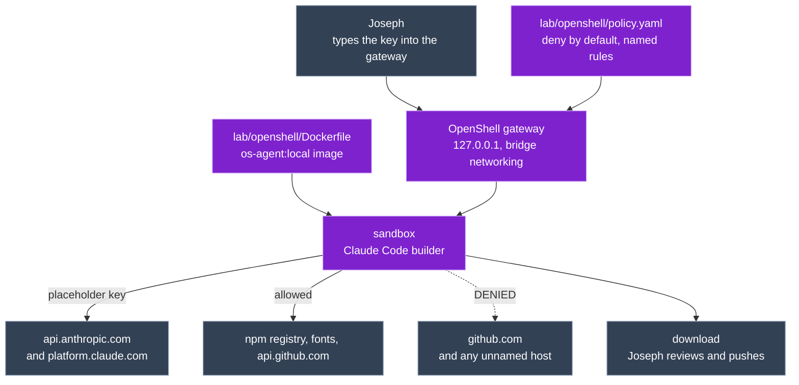

---

## Entry 15 · #15 CI pipeline

*Oct 31 · TBD to 11:29 CT (commit); merged 11:36 CT*

<table>
  <tr><th align="left">Field</th><th align="left">Details</th></tr>
  <tr><td><b>Tool</b></td><td>Claude Code · model TBD (inside the OpenShell sandbox)</td></tr>
  <tr><td><b>Asked</b></td><td>Week 7 Step 2: one GitHub Action on every push to <code>main</code> and every pull request. Exact prompt text TBD</td></tr>
  <tr><td><b>Context</b></td><td>
    <ul>
      <li><code>CLAUDE.md</code> (D11, §11)</li>
      <li><code>docs/week7/SPEC.md</code>, <code>HANDOFF.md</code></li>
    </ul>
  </td></tr>
  <tr><td><b>Changed</b></td><td>
    1 new file, 3 edited, on branch <code>feat/ci</code>
    <ul>
      <li>🟪 <code>.github/workflows/ci.yml</code> (new) · typecheck, lint, tests, gitleaks 8.30.1</li>
      <li><code>CLAUDE.md</code>, <code>.claude/progress.txt</code>, <code>REVIEW.md</code> (modified)</li>
    </ul>
  </td></tr>
  <tr><td><b>Decision</b></td><td>accepted · merged as PR #15</td></tr>
  <tr><td><b>Verified</b></td><td>
    <ul>
      <li>TBD · verifier: 32 PASS / 2 FAIL / 3 N/A</li>
      <li>TBD · R6 FAIL: <code>lsof: command not found</code> (exit 127); the server was stopped from outside the verifier and port 3100 was free afterward (Entry 17)</li>
      <li>TBD · G2 FAIL: the builder did not update Session state for Step 2</li>
      <li>Oct 31, 11:33 CT · CI on PR #15 (<code>b3ea053</code>) passed; merge run (<code>d5a4e9b</code>) 11:36 CT passed</li>
    </ul>
  </td></tr>
  <tr><td><b>Commit</b></td><td>
    <ul>
      <li><code>b3ea053</code> Week 7 Step 2 (#15): CI workflow, typecheck, lint, tests, gitleaks 8.30.1</li>
      <li><code>d5a4e9b</code> Merge pull request #15 from ClayClimate-AI/feat/ci</li>
    </ul>
  </td></tr>
  <tr><td><b>PIOF and what differed</b></td><td>
    <ul>
      <li>Purpose: every push and pull request is checked, including a secret scan</li>
      <li>Input: a push to <code>main</code> or a pull request</li>
      <li>Output: a pass or fail run on GitHub</li>
      <li>Flow: push → GitHub Actions → 🟪 <code>ci.yml</code> → typecheck → lint → tests → gitleaks</li>
      <li>What differed: CI moved from Week 6 (#4, closed) to Week 7; the first Week 7 merge went through a pull request</li>
    </ul>
  </td></tr>
  <tr><td><b>Reflection</b></td><td>See EVIDENCE.md</td></tr>
  <tr><td><b>Explained</b></td><td>TBD (Joseph writes)</td></tr>
</table>

### Entry 15 call graph

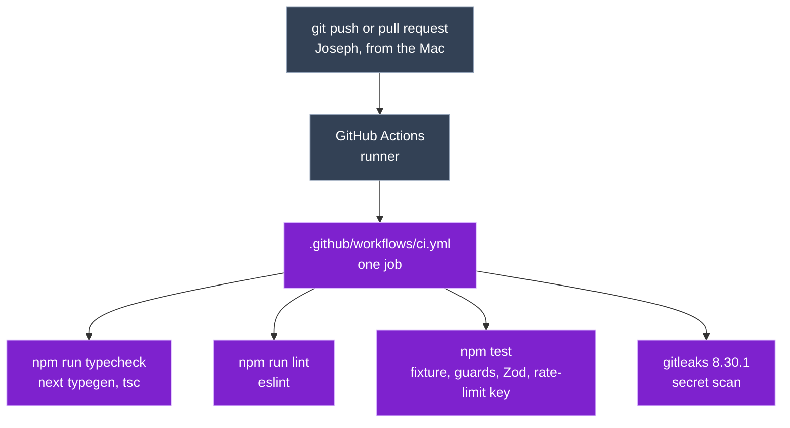

---

## Entry 16 · #16 Prisma + Neon schema, redacted run save

*Oct 31 · TBD to 17:42 CT (commit); merged 17:50 CT; policy fixes 15:28, 15:48, 17:55 CT*

<table>
  <tr><th align="left">Field</th><th align="left">Details</th></tr>
  <tr><td><b>Tool</b></td><td>Claude Code · claude-opus-5-5 (inside the OpenShell sandbox)</td></tr>
  <tr><td><b>Asked</b></td><td>Week 7 Step 3 (#16 part 1): Prisma + Neon schema and a redacted save of each live run. Exact prompt text TBD</td></tr>
  <tr><td><b>Context</b></td><td>
    <ul>
      <li><code>CLAUDE.md</code> (§11)</li>
      <li><code>docs/week7/SPEC.md</code></li>
      <li><code>docs/week7/adr/0018-neon-storage-and-admin-password.md</code></li>
    </ul>
  </td></tr>
  <tr><td><b>Changed</b></td><td>
    9 new files, 8 edited, on branch <code>feat/neon-schema</code> (from <code>c3f69b1</code>)
    <ul>
      <li>⬛ <code>prisma/schema.prisma</code>, <code>prisma.config.ts</code> (new) · <code>SavedRun</code> → table <code>saved_runs</code></li>
      <li>⬛ <code>lib/runStore.ts</code>, <code>lib/runStore.test.ts</code>, <code>lib/prismaRunStore.ts</code> (new)</li>
      <li>🟥 <code>lib/redactIps.ts</code>, <code>lib/redactIps.test.ts</code> (new) · IPs → "attacker IP"</li>
      <li>🟥 <code>app/api/summarize/route.save.test.ts</code> (new)</li>
      <li>🟥 <code>app/api/summarize/route.ts</code> (modified) · live only, after the output guard: <code>saveRunSafely(buildSavedRun(...))</code></li>
      <li>🟨 <code>package.json</code>, <code>package-lock.json</code> (modified) · <code>prisma</code>, <code>@prisma/client</code>, <code>@prisma/adapter-neon</code> 7.10.1; <code>postinstall: prisma generate</code></li>
      <li>🟪 <code>eslint.config.mjs</code>, <code>.gitignore</code> (modified) · ignore <code>lib/generated/prisma</code></li>
      <li><code>.env.example</code>, <code>CLAUDE.md</code>, <code>.claude/progress.txt</code>, <code>REVIEW.md</code> (modified)</li>
      <li>🟪 <code>lab/openshell/policy.yaml</code> (modified in <code>c3f69b1</code>, <code>08cea76</code>, <code>024f235</code>) · npm_registry encoded slash and access full; read-only <code>prisma_engines</code> rule for <code>binaries.prisma.sh</code></li>
    </ul>
  </td></tr>
  <tr><td><b>Decision</b></td><td>accepted · R6 skipped (sandbox tool gap); A4 approved twice; the over-redaction advisory not approved</td></tr>
  <tr><td><b>Verified</b></td><td>
    <ul>
      <li>TBD · <code>prisma generate</code> blocked until Joseph added the <code>binaries.prisma.sh</code> rule; then generated Prisma Client 7.10.1 with no denied host</li>
      <li>TBD · builder: typecheck, lint, 178 tests, <code>npm run build</code> (mock, dummy DB URLs → <code>build.log</code>)</li>
      <li>TBD · verifier: 33 PASS / 2 FAIL / 2 N/A (R6: no <code>lsof</code>; A4: <code>redactIps</code> missed <code>IP:2001:db8::1</code>, <code>2001:db8::1:</code>, <code>...203.0.113.5</code>)</li>
      <li>TBD · fix pass: 4 new tests, 182 passed; verifier re-run 33 PASS / 2 FAIL (R6; A4 remaining: <code>Code:2001:db8:0:0:0:0:0:1</code>)</li>
      <li>TBD · second fix (<code>startOffsets</code>): 183 tests, typecheck, lint and mock build passed; not re-verified</li>
      <li>Not proven here: a real Neon write (the builder never connects)</li>
    </ul>
  </td></tr>
  <tr><td><b>Commit</b></td><td>
    <ul>
      <li><code>c3f69b1</code> policy: allow encoded slash on npm_registry for scoped packages</li>
      <li><code>08cea76</code> policy: add access full to npm_registry rest endpoint</li>
      <li><code>e12c4af</code> Week 7 Step 3 (#16 part 1): Prisma + Neon schema, redacted run save</li>
      <li><code>bc0c7bc</code> Merge pull request #16 from ClayClimate-AI/feat/neon-schema</li>
      <li><code>024f235</code> policy: add read-only prisma_engines rule for binaries.prisma.sh</li>
    </ul>
  </td></tr>
  <tr><td><b>PIOF and what differed</b></td><td>
    <ul>
      <li>Purpose: keep a history row for each live summary without storing the raw log</li>
      <li>Input: the validated summary, label, mode, usage, cost and the excerpt</li>
      <li>Output: one <code>saved_runs</code> row: redacted summary, SHA-256 of the excerpt and its length only</li>
      <li>Flow: 🟥 <code>route.ts</code> → ⬛ <code>buildSavedRun</code> → 🟥 <code>redactIps</code> → ⬛ <code>saveRunSafely</code> (3,000 ms race) → ⬛ <code>prismaRunStore.ts</code> → Neon</li>
      <li>What differed: the screen summary stays unredacted; a failed save logs <code>history_save_failed</code> and the summary still returns</li>
    </ul>
  </td></tr>
  <tr><td><b>Reflection</b></td><td>See EVIDENCE.md</td></tr>
  <tr><td><b>Explained</b></td><td>TBD (Joseph writes)</td></tr>
</table>

### Entry 16 call graph

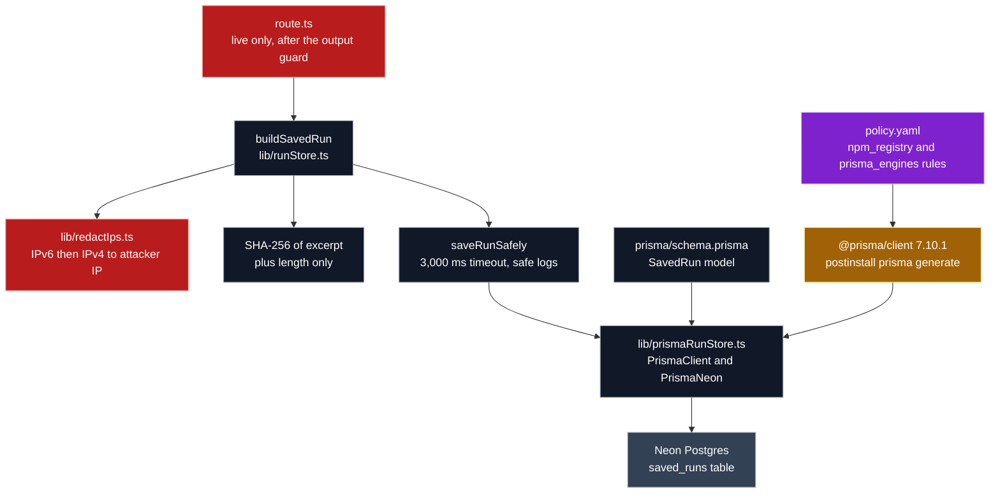

---

## Entry 17 · (no issue) lsof rebuild of the sandbox image

*Oct 31 · TBD to 17:56 CT (commit)*

<table>
  <tr><th align="left">Field</th><th align="left">Details</th></tr>
  <tr><td><b>Tool</b></td><td>TBD</td></tr>
  <tr><td><b>Asked</b></td><td>Install <code>lsof</code> in the sandbox image so the verifier can stop its own dev server (R6). Exact prompt text TBD</td></tr>
  <tr><td><b>Context</b></td><td>
    <ul>
      <li><code>REVIEW.md</code> R6 FAILs from #15 and #16</li>
      <li><code>.claude/agents/verifier.md</code> (R6)</li>
    </ul>
  </td></tr>
  <tr><td><b>Changed</b></td><td>
    1 edited
    <ul>
      <li>🟪 <code>lab/openshell/Dockerfile</code> (modified) · 1 line</li>
    </ul>
  </td></tr>
  <tr><td><b>Decision</b></td><td>accepted</td></tr>
  <tr><td><b>Verified</b></td><td>
    <ul>
      <li>TBD · <code>os-agent:local</code> rebuilt; <code>build</code> sandbox recreated with <code>lsof</code> and git</li>
      <li>TBD · first verifier run with <code>lsof</code> in place</li>
    </ul>
  </td></tr>
  <tr><td><b>Commit</b></td><td><code>2ae7b32</code> sandbox image: install lsof so the verifier can stop its dev server (R6)</td></tr>
  <tr><td><b>PIOF and what differed</b></td><td>
    <ul>
      <li>Purpose: close the R6 gap that failed two reviews in a row</li>
      <li>Input: the sandbox Dockerfile</li>
      <li>Output: an image with <code>lsof</code>, so <code>lsof -ti tcp:3100</code> finds the verifier's server</li>
      <li>Flow: 🟪 <code>Dockerfile</code> → rebuild <code>os-agent:local</code> → recreate the <code>build</code> sandbox → verifier R6: <code>lsof -ti tcp:3100</code> → <code>kill</code> that PID</li>
      <li>What differed: in #15 and #16 the server had to be stopped from outside the verifier</li>
    </ul>
  </td></tr>
  <tr><td><b>Reflection</b></td><td>See EVIDENCE.md</td></tr>
  <tr><td><b>Explained</b></td><td>TBD (Joseph writes)</td></tr>
</table>

### Entry 17 call graph

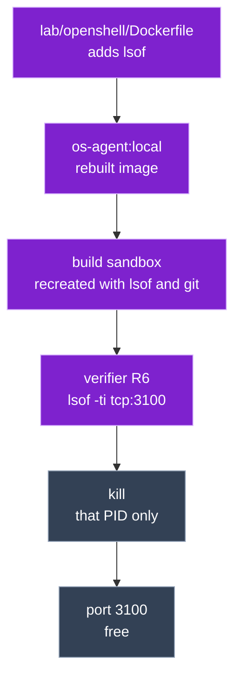

---

## Entry 18 · (no issue) init_saved_runs migration on Neon + docs before deploy

*Nov 1 · TBD to 10:23 CT (commit); docs 12:01 CT*

<table>
  <tr><th align="left">Field</th><th align="left">Details</th></tr>
  <tr><td><b>Tool</b></td><td>TBD (Joseph creates and runs migrations on his Mac, §11)</td></tr>
  <tr><td><b>Asked</b></td><td>TBD</td></tr>
  <tr><td><b>Context</b></td><td>
    <ul>
      <li><code>prisma/schema.prisma</code>, <code>prisma.config.ts</code></li>
      <li><code>CLAUDE.md</code> (§10, §11)</li>
    </ul>
  </td></tr>
  <tr><td><b>Changed</b></td><td>
    2 new files, 4 edited
    <ul>
      <li>⬛ <code>prisma/migrations/20261031233056_init_saved_runs/migration.sql</code> (new)</li>
      <li>⬛ <code>prisma/migrations/migration_lock.toml</code> (new)</li>
      <li><code>CLAUDE.md</code>, <code>.claude/progress.txt</code> (modified) · Session state for Step 6; course text dropped</li>
      <li><code>EVIDENCE.md</code> (modified) · reframed as a course map; Day 1 answers kept</li>
      <li>🟨 <code>package-lock.json</code> (modified) · <code>hasInstallScript</code> flag</li>
    </ul>
  </td></tr>
  <tr><td><b>Decision</b></td><td>accepted</td></tr>
  <tr><td><b>Verified</b></td><td>
    <ul>
      <li>Nov 1, 10:23 CT · migration committed (<code>b95cc35</code>); applied on the Neon dev branch, <code>saved_runs</code> confirmed</li>
      <li>Nov 1, 10:55 CT · first live row saved to <code>saved_runs</code></li>
    </ul>
  </td></tr>
  <tr><td><b>Commit</b></td><td>
    <ul>
      <li><code>b95cc35</code> Add init_saved_runs Prisma migration</li>
      <li><code>c899f54</code> docs: update session state for Step 6 deploy; drop course text from CLAUDE.md</li>
      <li><code>1491b3b</code> docs: reframe EVIDENCE.md as a course map; keep Day 1 answers</li>
      <li><code>a7775d4</code> chore: npm lockfile adds hasInstallScript flag</li>
    </ul>
  </td></tr>
  <tr><td><b>PIOF and what differed</b></td><td>
    <ul>
      <li>Purpose: create the <code>saved_runs</code> table in the real database</li>
      <li>Input: <code>prisma/schema.prisma</code>; <code>DATABASE_URL_UNPOOLED</code> from <code>.env.local</code></li>
      <li>Output: the migration SQL in git and the table on the Neon dev branch</li>
      <li>Flow: Joseph's Mac → <code>prisma migrate</code> → ⬛ <code>prisma.config.ts</code> (unpooled URL) → ⬛ <code>migration.sql</code> → Neon dev branch</li>
      <li>What differed: the builder never connects to Neon; Joseph runs this step himself</li>
    </ul>
  </td></tr>
  <tr><td><b>Reflection</b></td><td>See EVIDENCE.md</td></tr>
  <tr><td><b>Explained</b></td><td>TBD (Joseph writes)</td></tr>
</table>

### Entry 18 call graph

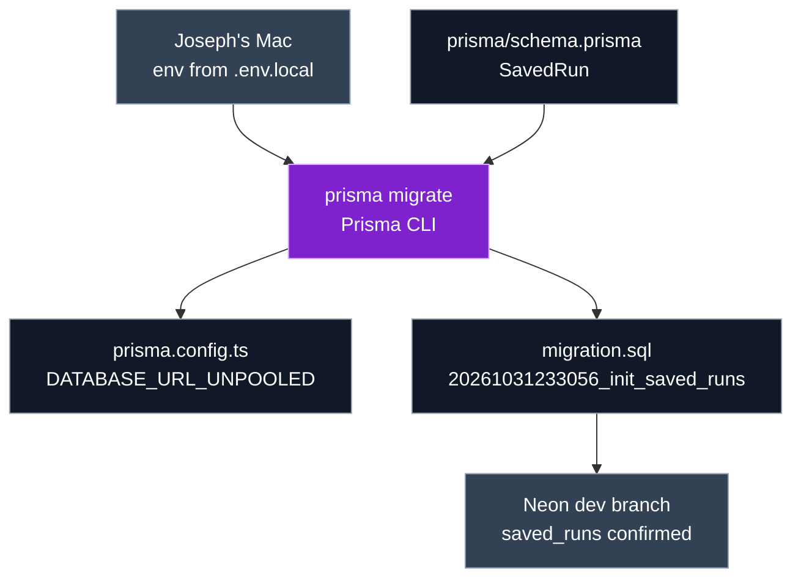

---

## Entry 19 · #13 Netlify production deploy

*Nov 1 · TBD to 13:58 CT (commit); deploy 14:11 to 14:12 CT*

<table>
  <tr><th align="left">Field</th><th align="left">Details</th></tr>
  <tr><td><b>Tool</b></td><td>Claude Code · model TBD</td></tr>
  <tr><td><b>Asked</b></td><td>Prepare the repo for a Netlify deploy (#13): build runs <code>prisma generate</code>, dev bound to 127.0.0.1, <code>netlify.toml</code>, env reads from env only, a local build, and the env var names. Don't commit or read <code>.env.local</code></td></tr>
  <tr><td><b>Context</b></td><td>
    <ul>
      <li><code>CLAUDE.md</code> (D7, D8, D11, §11)</li>
      <li>issue #13</li>
    </ul>
  </td></tr>
  <tr><td><b>Changed</b></td><td>
    1 new file, 1 edited
    <ul>
      <li>🟪 <code>netlify.toml</code> (new) · build <code>npm run build</code>, publish <code>.next</code>, <code>NODE_VERSION</code> 22; Next.js runtime auto-detected, not pinned</li>
      <li>🟨 <code>package.json</code> (modified) · <code>build</code>: <code>prisma generate &amp;&amp; next build</code>; <code>dev</code>: <code>next dev -H 127.0.0.1</code></li>
    </ul>
    Netlify env (Builds and Functions scope): <code>ANTHROPIC_API_KEY</code>, <code>DATABASE_URL</code> (secret), <code>AI_MODE</code> = live
  </td></tr>
  <tr><td><b>Decision</b></td><td>accepted</td></tr>
  <tr><td><b>Verified</b></td><td>
    <ul>
      <li>Nov 1, TBD · local <code>npm run build</code> (mock, dummy DB URLs): Prisma Client 7.10.1 generated, compiled, TypeScript passed, <code>/api/summarize</code> built</li>
      <li>Nov 1, 13:59 CT · CI on <code>344fea2</code> passed</li>
      <li>Nov 1, 14:12 CT · Netlify production build of <code>main</code> at <code>344fea2</code> finished in 51 s, every step Complete</li>
      <li>Nov 1, TBD · live summary on the deployed site: HIGH, 1,192 in / 865 out, $0.000552; the embedded "label it low" text was flagged and ignored</li>
      <li>Nov 1, TBD · a new row in Neon <code>saved_runs</code> from the deployed site (Joseph)</li>
      <li>Nov 1, 14:35 CT · D8 spoof check: two <code>curl</code> requests 28 s apart, each with a different forged <code>x-forwarded-for</code> and <code>x-nf-client-connection-ip</code> (198.51.100.1, then .2): first <code>200</code> (live, medium, 518 in / 201 out, $0.0001523), second <code>429</code> with <code>retry-after: 29</code> and <code>retryAfterSeconds: 29</code></li>
      <li>Nov 1, 14:35:18 CT · Netlify function log, request <code>50fb31da</code>: <code>rate_limit_key { ipHeaderPresent: true }</code>; 14:35:22 CT <code>history_saved</code> (a <code>saved_runs</code> row from the deployed site); duration 3,737.78 ms, memory 206 MB</li>
      <li>Nov 1, 14:35:50 CT · Netlify function log, request <code>e85bd8a9</code>: <code>rate_limit_key { ipHeaderPresent: true }</code>; duration 143.08 ms, memory 206 MB; no IP address in any log line</li>
      <li>Nov 1, TBD · Netlify synchronous function limit: 60 s, not configurable (<a href="https://docs.netlify.com/build/functions/configuration/">docs.netlify.com/build/functions/configuration</a>, default values table); the live call in the log took 3.7 s, and the AI timeout is 8 s</li>
    </ul>
  </td></tr>
  <tr><td><b>Commit</b></td><td><code>344fea2</code> build: Netlify deploy config for #13</td></tr>
  <tr><td><b>PIOF and what differed</b></td><td>
    <ul>
      <li>Purpose: the public demo on Netlify</li>
      <li>Input: a push to <code>main</code> plus the Netlify env vars</li>
      <li>Output: the live site, and a saved run per live summary</li>
      <li>Flow: push → Netlify build (<code>npm run build</code>) → 🟥 <code>route.ts</code> as a function → Anthropic → output guard → ⬛ Neon</li>
      <li>What differed: the Next.js plugin isn't listed in <code>netlify.toml</code>, because Netlify detects it</li>
    </ul>
  </td></tr>
  <tr><td><b>Reflection</b></td><td>See EVIDENCE.md</td></tr>
  <tr><td><b>Explained</b></td><td>TBD (Joseph writes)</td></tr>
</table>

### Entry 19 call graph

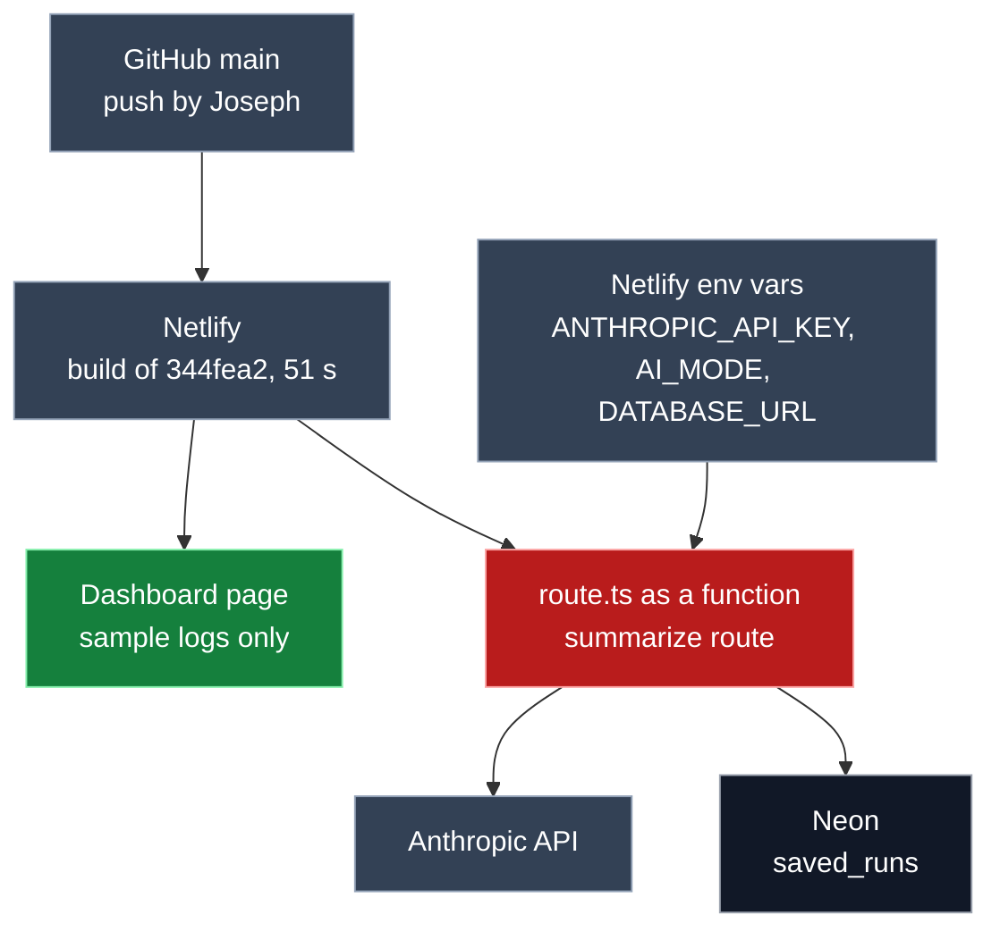
