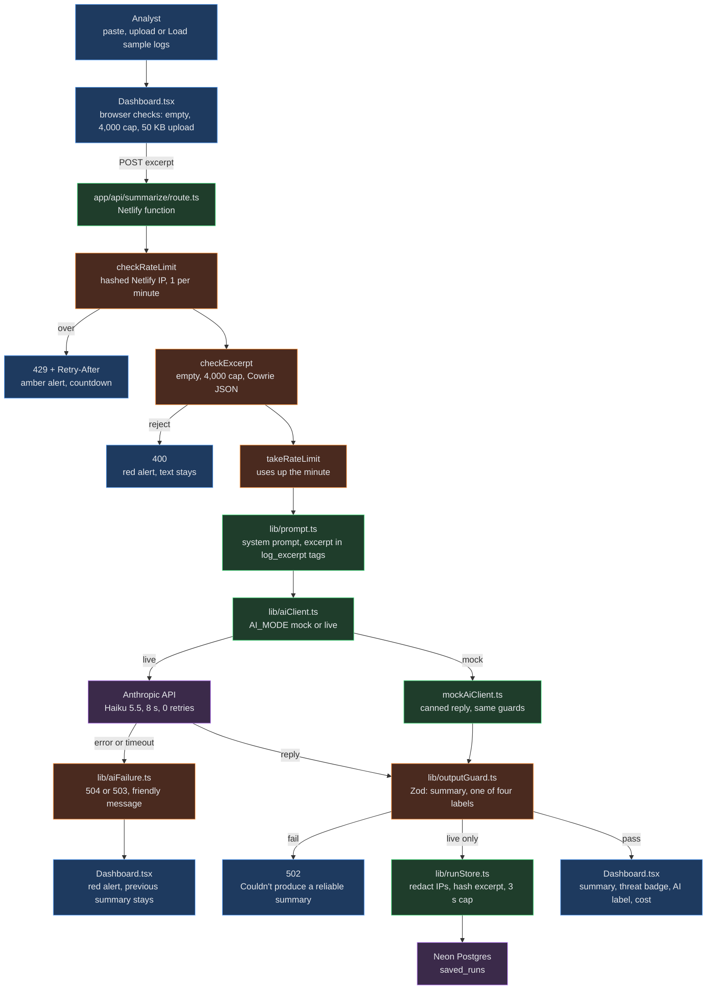

Defensive learning project: a local SSH honeypot plus an AI that summarizes attacker behavior for defenders.

<h1 align="center">Cowrie Log Summarizer</h1>
<p align="center"><b>Live site:</b> <a href="https://honeypot-log-analyzer.netlify.app">honeypot-log-analyzer.netlify.app</a> · sample logs only</p>
<p align="center"><b>Companion pages:</b> <a href="https://honeypot-log-analyzer-data-flow.netlify.app/">data flow</a> · <a href="https://honeypot-log-analyzer-openshell-demo.netlify.app/">OpenShell demo</a></p>
<p align="center">
  <a href="https://github.com/ClayClimate-AI/honeypot-log-analyzer/actions/workflows/ci.yml"></a>
  <a href="https://honeypot-log-analyzer.netlify.app"></a>
  <a href="https://www.docker.com/"></a>
  <a href="https://github.com/NVIDIA/OpenShell"></a>
  <a href="https://nextjs.org/"></a>
</p>

---

## 1. What it is and why

A Next.js app that sends a capped excerpt (4,000 characters) of a [Cowrie](https://github.com/cowrie/cowrie) SSH honeypot log to Claude Haiku 5.5 and shows a short summary plus a threat label (low, medium, high or unknown) for a security analyst: what happened, what it means, and what to watch.

Built as the Week 6 project ("Add a Reliable AI Feature") and upgraded in Week 7.

**Threat model:** this is defensive research for defenders, not an attack tool, and the honeypot is never exposed publicly.

### Guardrails around the AI call

    Summarize request
    ├── Input guard    → empty, over the cap, or not Cowrie JSON is rejected before any call
    ├── AI call        → Claude Haiku 5.5
    ├── Output guard   → a Zod schema checks the reply before anything is shown
    └── Failure guard  → 8 s timeout, no retries, a friendly message for every error

### Storage

- Live summaries are saved to Neon Postgres.
- Attacker IPs are replaced by "attacker IP".
- The raw log is never stored.

### Build environment

    Build side (OpenShell)
    ├── Sandbox around the Claude CLI builder
    ├── Docker container from os-agent:local (lab/openshell/Dockerfile)
    ├── Builder held only a placeholder key
    └── Outbound traffic limited to allowed sites (lab/openshell/policy.yaml)

    Run side (Netlify)
    └── Protected by the Week 6 code guardrails; OpenShell never touches it

    Log source
    └── Cowrie in Docker Desktop on my machine (SSH on port 2222 in the container), never exposed

Walkthrough: [OpenShell demo](https://honeypot-log-analyzer-openshell-demo.netlify.app/)

### Boundaries

- **Local only.** Cowrie runs in Docker on my own machine. Test sessions are me SSHing into localhost.

- **Observe and explain only.** No scanning other machines, no exploit code, no attack tooling, no collecting other people's credentials.

- **Defender framing.** The AI summarizes what happened, what it means, and what to watch. It never explains how to attack.

- **Sample logs only.** The public site uses a sanitized sample (`fixtures/sample-session.jsonl`: documentation IP ranges, reserved domains, default passwords). The honeypot is never reachable from the site.

- **No real attacker data leaves the machine,** except the capped excerpt sent to the AI API for summarization.

### Data flow

One Summarize request, in the order `app/api/summarize/route.ts` runs it:

Interactive version: [data flow page](https://honeypot-log-analyzer-data-flow.netlify.app/)



Blue: browser · green: server · orange: guards · purple: outside services.

## 2. How to run it

**Local**

```bash
npm install            # also runs prisma generate (postinstall)
cp .env.example .env.local
npm run dev            # binds to 127.0.0.1 only: http://127.0.0.1:3000
```

Checks:

```bash
npm run typecheck
npm run lint
npm test
npm run build          # prisma generate, then next build
```

**Environment variables** (names only; values live in `.env.local`, which is git-ignored, and in Netlify):

| Name | Used for |
|---|---|
| `ANTHROPIC_API_KEY` | the live AI call (server only) |
| `AI_MODE` | `live` for real calls; unset or anything else means `mock` (no key needed) |
| `DATABASE_URL` | pooled Neon URL; saving live runs |

`DATABASE_URL_UNPOOLED` is used only by the Prisma CLI for migrations, run by hand, never by the app or by Netlify.

**Netlify deploy**

<p>The repo is linked to Netlify, so a push to <code>main</code> starts a production build. <code>netlify.toml</code> runs <code>npm run build</code> (<code>prisma generate</code>, then <code>next build</code>) and publishes <code>.next</code> on Node 22; Netlify detects the Next.js runtime itself, so no plugin is pinned. The summarize route runs as a Netlify function. The three variables above are set in the Netlify UI with Builds and Functions scope, and the two secrets are marked as secret values. GitHub Actions (<code>.github/workflows/ci.yml</code>) runs typecheck, lint, tests and a gitleaks secret scan on every push to <code>main</code> and every pull request.</p>

**Rate limit (known limitation)**

<p>One summary per minute per client. The client is identified only by Netlify's <code>x-nf-client-connection-ip</code> header, hashed before it is stored and never logged; forwarding headers such as <code>x-forwarded-for</code> are ignored. Without that header (always the case locally), every request shares one bucket. The limiter is in memory, so each function instance keeps its own count and a cold start resets it; the hard backstop is the monthly spend limit on the Anthropic workspace that holds the key.</p>

## 3. What the production logs proved (Nov 1, CT)

- **D8 spoof check:** two `curl` requests 28 s apart, each with a different forged IP in `x-forwarded-for` and `x-nf-client-connection-ip`, got `200` and then `429` (`retry-after: 29`). The 429 took 143 ms.
- **The header reaches the route:** `rate_limit_key` showed `ipHeaderPresent: true` on both requests, and no IP address appears in any log line.
- **The database write works:** the live call (request `50fb31da`) logged `history_saved` at 14:35:22 CT, took 3,737.78 ms, and used 206 MB of memory.
- **Time limits:** Netlify's synchronous function limit is 60 s ([Netlify docs](https://docs.netlify.com/build/functions/configuration/)), and the AI timeout is 8 s, so the fallback message always arrives first.

## 4. What's still open

TBDs remaining in [`PROMPT_LOG.md`](PROMPT_LOG.md):

- Start times for every entry (only commit times are recorded).
- Exact prompt text for every entry.
- The model for entries whose commits have no co-author line (only Entries 4, 6, 7 and 16 name it).
- Clock times on most Verified checks.
- Entry 1: Tool and Asked. Entry 3: Verified.
- Entry 17: Tool, the image rebuild check, and the first verifier run with `lsof`.
- Entry 18: Tool and Asked.
- Entry 19: the time of the browser live summary (HIGH, 1,192 in / 865 out) and of the `saved_runs` row it created.
- Every Explained row (Joseph writes).

Also open outside the log: history pages and admin login (Week 7 Step 4) and cost per saved run (Step 5), both skipped for now; the rest of #14 (full code review, verifier checks 1 to 12, your review of the data-flow diagram).
