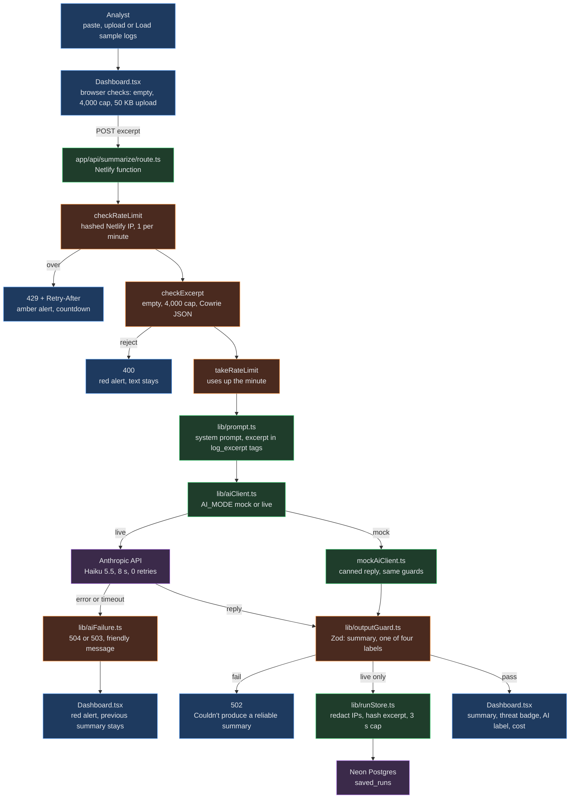

Defensive learning project: a local SSH honeypot plus an AI that summarizes attacker behavior for defenders.

<h1 align="center">Cowrie Log Summarizer</h1>
<p align="center"><b>Live site:</b> <a href="https://honeypot-log-analyzer.netlify.app">honeypot-log-analyzer.netlify.app</a> · sample logs only</p>
<p align="center">
  <a href="https://github.com/ClayClimate-AI/honeypot-log-analyzer/actions/workflows/ci.yml"></a>
  <a href="https://honeypot-log-analyzer.netlify.app"></a>
  <a href="https://www.docker.com/"></a>
  <a href="https://github.com/NVIDIA/OpenShell"></a>
  <a href="https://nextjs.org/"></a>
</p>

---

## Project links

### Planned (before the build)
- [3D trace of the original plan](https://jc-week6-ai-api-3d-330.netlify.app). This was the plan before building. See Built below for what actually shipped and what changed.

### Built (what shipped)
- [Live app](https://honeypot-log-analyzer.netlify.app). Cowrie AI Summarizer, sample logs only.
- [Data flow of the real build](https://honeypot-log-analyzer-data-flow.netlify.app). How a request moves through the guards, the AI call, and the save.
- [E4 and E5: catch an attack, keep none of it](https://e4-e5-honeypot.netlify.app). Honeypot capture and the sanitizing step.
- [OpenShell build safety demo](https://honeypot-log-analyzer-openshell-demo.netlify.app). How the builder agent was sandboxed with a placeholder key.

## 1. What it is and why

A Next.js app that sends a capped excerpt (4,000 characters) of a [Cowrie](https://github.com/cowrie/cowrie) SSH honeypot log to Claude Haiku 5.5 and shows a short summary plus a threat label (low, medium, high or unknown) for a security analyst: what happened, what it means, and what to watch.

Built as the Week 6 project ("Add a Reliable AI Feature") and upgraded in Week 7.

**Threat model:** this is defensive research for defenders, not an attack tool, and the honeypot is never exposed publicly.

### Guardrails around the AI call

    Summarize request
    ├── Input guard    → empty, over the cap, or not Cowrie JSON is rejected before any call
    ├── AI call        → Claude Haiku 5.5
    ├── Output guard   → a Zod schema checks the reply before anything is shown
    └── Failure guard  → 8 s timeout, no retries, a friendly message for every error

### Storage

- Live summaries are saved to Neon Postgres.
- Attacker IPs are replaced by "attacker IP".
- The raw log is never stored.

### Build environment

    Build side (OpenShell)
    ├── Sandbox around the Claude CLI builder
    ├── Docker container from os-agent:local (lab/openshell/Dockerfile)
    ├── Builder held only a placeholder key
    └── Outbound traffic limited to allowed sites (lab/openshell/policy.yaml)

    Run side (Netlify)
    └── Protected by the Week 6 code guardrails; OpenShell never touches it

    Log source
    └── Cowrie in Docker Desktop on my machine (SSH on port 2222 in the container), never exposed

Walkthrough: [OpenShell demo](https://honeypot-log-analyzer-openshell-demo.netlify.app/)

### Boundaries

- **Local only.** Cowrie runs in Docker on my own machine. Test sessions are me SSHing into localhost.

- **Observe and explain only.** No scanning other machines, no exploit code, no attack tooling, no collecting other people's credentials.

- **Defender framing.** The AI summarizes what happened, what it means, and what to watch. It never explains how to attack.

- **Sample logs only.** The public site uses a sanitized sample (`fixtures/sample-session.jsonl`: documentation IP ranges, reserved domains, default passwords). The honeypot is never reachable from the site.

- **No real attacker data leaves the machine,** except the capped excerpt sent to the AI API for summarization.

### Data flow

One Summarize request, in the order `app/api/summarize/route.ts` runs it:

Interactive version: [data flow page](https://honeypot-log-analyzer-data-flow.netlify.app/)



Blue: browser · green: server · orange: guards · purple: outside services.

## 2. How to run it

**Local**

```bash
npm install            # also runs prisma generate (postinstall)
cp .env.example .env.local
npm run dev            # binds to 127.0.0.1 only: http://127.0.0.1:3000
```

Checks:

```bash
npm run typecheck
npm run lint
npm test
npm run build          # prisma generate, then next build
```

**Environment variables** (names only; values live in `.env.local`, which is git-ignored, and in Netlify):

| Name | Used for |
|---|---|
| `ANTHROPIC_API_KEY` | the live AI call (server only) |
| `AI_MODE` | `live` for real calls; unset or anything else means `mock` (no key needed) |
| `DATABASE_URL` | pooled Neon URL; saving live runs |

`DATABASE_URL_UNPOOLED` is used only by the Prisma CLI for migrations, run by hand, never by the app or by Netlify.

**Netlify deploy**

    git push to main
    ├── Netlify production build (netlify.toml)
    │   ├── npm run build → prisma generate, then next build
    │   ├── publishes .next on Node 22
    │   └── Next.js runtime detected by Netlify (no plugin pinned)
    ├── Summarize route → runs as a Netlify function
    └── GitHub Actions (.github/workflows/ci.yml), also on every pull request
        └── typecheck · lint · tests · gitleaks secret scan

- The three variables above are set in the Netlify UI with Builds and Functions scope.
- The two secrets are marked as secret values.

**Rate limit (known limitation)**

    One summary per minute per client
    ├── Client identity → Netlify's x-nf-client-connection-ip header only
    │   ├── hashed before it is stored
    │   └── never logged
    ├── Ignored         → forwarding headers such as x-forwarded-for
    ├── Header missing  → every request shares one bucket (always the case locally)
    ├── Storage         → in memory
    │   ├── each function instance keeps its own count
    │   └── a cold start resets it
    └── Hard backstop   → monthly spend limit on the Anthropic workspace that holds the key

## 3. What the production logs proved (Nov 1, CT)

| Check | How | Result |
|---|---|---|
| D8 spoof check | Two `curl` requests 28 s apart, each with a different forged IP in `x-forwarded-for` and `x-nf-client-connection-ip` | `200`, then `429` (`retry-after: 29`); the 429 took 143 ms |
| Header reaches the route | `rate_limit_key` log line | `ipHeaderPresent: true` on both requests; no IP address in any log line |
| Database write | Live call, request `50fb31da` | `history_saved` at 14:35:22 CT; 3,737.78 ms; 206 MB of memory |
| Time limits | Netlify synchronous limit 60 s ([Netlify docs](https://docs.netlify.com/build/functions/configuration/)) vs. AI timeout 8 s | The fallback message always arrives first |

## 4. What's still open

TBDs in [`PROMPT_LOG.md`](PROMPT_LOG.md):

```
PROMPT_LOG.md
├── Every entry
│   ├── Start times (only commit times are recorded)
│   ├── Exact prompt text
│   ├── Model, where the commit has no co-author line (only Entries 4, 6, 7 and 16 name it)
│   └── Clock times on most Verified checks
├── Entry 1  → Tool, Asked
├── Entry 3  → Verified
├── Entry 17 → Tool; the image rebuild check; the first verifier run with lsof
├── Entry 18 → Tool, Asked
└── Entry 19 → time of the browser live summary (HIGH, 1,192 in / 865 out)
               and of the saved_runs row it created
```

Outside the log:

```
Week 7
├── Step 4 → history pages and admin login (skipped for now)
├── Step 5 → cost per saved run (skipped for now)
└── #14    → verifier checks 1 to 12 pass; your review of the data flow diagram is left
```
